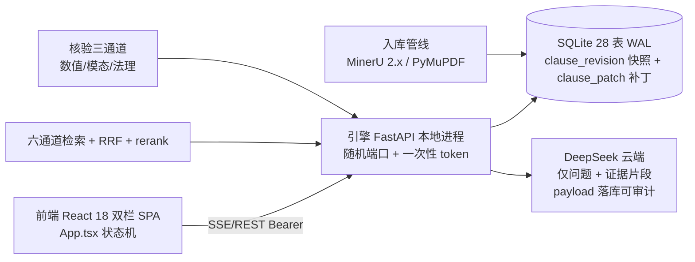

# KnowledgeStation 百科全书（ENCYCLOPEDIA）

> **项目全称**：通用国标与法律法规本地 AI 知识工作站（KnowledgeStation）
> **平台**：Windows 11 ｜ **文档日期**：2026-08-23（融合版，替代分散的 30 份交接/契约/框架文档的速查入口）
> **本文件定位**：本项目所有知识的**单入口百科全书**——概览、技术栈、架构、数据模型、检索链路、核验、前端、API、运维、测试、阶段史、已知坑、规则与红线，全部在此。信息不压缩，只剔除已确认过期的内容；过期项的删除理由见各节"过期待办"标注，台账见 PHASE-INDEX「增删记录」。

---

## 目录

1. [项目概览](#1-项目概览)
2. [技术栈与环境](#2-技术栈与环境)
3. [架构总览与进程模型](#3-架构总览与进程模型)
4. [数据模型与存储契约](#4-数据模型与存储契约)
5. [检索链路（六通道 + RRF + Rerank）](#5-检索链路)
6. [LLM 层与追问机制](#6-llm-层与追问机制)
7. [核验层](#7-核验层)
8. [入库管线与 bbox 契约](#8-入库管线与-bbox-契约)
9. [前端（双栏 UI / PDF 穿透 / 引用链接 / 纠错）](#9-前端)
10. [合规引擎与导出](#10-合规引擎与导出)
11. [API 与 SSE 契约](#11-api-与-sse-契约)
12. [运维（启动 / 引擎发现 / 备份 / 外发审计）](#12-运维)
13. [测试体系与 Golden Set 门禁](#13-测试体系)
14. [阶段史（phase1~14 脉络与产出）](#14-阶段史)
15. [已知坑与历史事故](#15-已知坑与历史事故)
16. [规则、红线与优先级宪法](#16-规则红线与优先级宪法)
17. [未实现 / 挂起 / 条件触发清单](#17-未实现挂起条件触发清单)
18. [文档索引与接手指南](#18-文档索引与接手指南)

---

# 1. 项目概览

## 1.1 一句话定位

把国标/法规 PDF 变成**可检索、可溯源、可纠错、可落检查表**的本地知识库：回答每条结论都带"标准号-条款号"引用，点引用即可跳到 PDF 原文对应位置黄框高亮核对；LLM 只接收"问题 + 本地检索的证据片段"；每次外发 payload 落库可审计。

## 1.2 目标用户与典型场景

- **用户**：企业安全/环保/合规/工程人员（危化、消防、施工、工贸等行业）。
- **典型问题**："动火作业怎么分级""气体探头装多高""消防疏散宽度多少""我要搞个高处作业，咋看多少级"。

## 1.3 现状痛点（产品要解决的问题）

1. 国标/法规 PDF 动辄几十上百页，条文分散，人工翻阅慢且容易漏。
2. 同一主题存在多个版本（强标/推标、已废止/未生效/替代关系），用错版本是合规事故。
3. 网上搜到的"答案"无法确认出处，通用 AI 常编造条款——**合规场景不允许不可溯源的回答**。
4. （已修订）涉密/内部场景不允许把标准内容发到云端大模型——该"零外发"红线 2026-08-23 由业主决策 **D1 废止**，改为"外发可审计"（见 §16.2）。
5. 光回答"应该做什么"不够，还要能落地：生成义务清单、检查表、制度差距分析。

## 1.4 产品形态：双栏交互

- **左栏**：对话问答（微信式气泡）+ 追问卡 + 纠错编辑（Word 式，表格可操作）。
- **右栏**：PDF 原件穿透区 + 证据卡片（置信度徽章/修订记录/收藏/批注/操作）+ 条款操作。
- **为什么双栏**：合规核对需要"一边看 AI 结论、一边看原文"同时进行；只给文字无法建立信任。

## 1.5 产品承诺（验收红线，v2 版，替代 v4.3 §1.3）

1. **可溯源**（不变）：每条结论带标准号-条款号引用，可点回原文核对。
2. **数据可信**（加强）：OCR 可纠、可体检、可集中修；修订留痕可撤销；快照不可变且 **SHA-256 可验证**；补丁作用域绑定 `(standard_id, version_id, clause_key, revision_hash)`，**解析不出的补丁拒绝落库**。
3. **版本正确**（不变）：引用自动指向现行有效版本，已废止/未生效有提示。
4. **外发可审计**（新，替代"零外发"）：每次 LLM/rerank/云解析调用的完整 payload 落库（Debug Trace 通道），用户可在 UI 查看"我的哪些内容发往了哪个服务"，可导出。红线语义从"不发"变为"**发的每一条都可见、可追责**"。
5. **额度克制**（不变）：云调用预算控制（历史截断、追问单轮封顶、月度额度看板）。
6. **引用准确率门禁**（新）：Golden Set 的引用精确率/条款召回率设阈值进 CI，检索/提示词任何改动掉指标即卡住。

## 1.6 需求编号体系（SSOT：主计划 v4.3）

- 功能需求 **R1~R79** + 法理/合规需求 **R-L1~L14** + 工程任务 **T00~T13**。
- 主计划原件：`C:/Users/Zegel/Downloads/1-v4.3 (1).md`（仓库根有工作副本 `1-v4.3 (1).md`）。
- 需求状态全量对照：`docs/onboarding/coverage-matrix.md`（94 项）；实现审计：`docs/onboarding/requirements-audit.md`。
- ⚠ 注意层次：**主计划 v4.3 是需求源头 SSOT；现行最高指导是 `docs/FRAMEWORK-v5-priority-realignment.md` + `docs/ROADMAP-v5-execution-plan.md`**（v5 框架决策已修订 v4.3 的部分红线，见 §16）。

---

# 2. 技术栈与环境

## 2.1 技术栈总表

| 层 | 技术 | 版本/说明 |
|---|---|---|
| 后端 | Python（**3.12.14**，uv 安装） | ⚠ 勿用系统 3.14（pydantic-core/fasttext 无 wheel） |
| Web 框架 | FastAPI + uvicorn | 本地引擎，随机端口 + 一次性 Bearer token |
| 数据 | SQLite 单文件（WAL） | `%APPDATA%\KnowledgeStation\database\knowledge.db`；`journal_mode=WAL`、`foreign_keys=ON`、`busy_timeout=5000` |
| 向量 | sqlite-vec（vec0，512 维） | bge-small-zh-v1.5；查询前必须 `load_vec_extension(conn)` |
| 全文 | FTS5 + jieba 预分词 | tokenize='ascii'，中文分词写入；`_fts_query()` 对分词加引号过滤 |
| Embedding | fastembed（bge-small-zh-v1.5） | 本地缓存 `%APPDATA%\KnowledgeStation\models\`，离线可用 |
| Rerank | fastembed（BAAI/bge-reranker-base） | CPU/ONNX，~400MB；离线自动降级 |
| LLM | DeepSeek（OpenAI 兼容） | 流式；Key 存用户环境变量 `KS_LLM_API_KEY`（2026-09-11 起；旧名 `DEEPSEEK_API_KEY` 仅只读回退）或注册表回退 |
| OCR | MinerU 2.x（`mineru` 包，magic-pdf 继任） | 深度版面分析；可降级到 PyMuPDF 文本层 |
| 前端 | React 18 + Vite 5 + TypeScript | 双栏 SPA |
| PDF 渲染 | pdfjs-dist 3.11 | 连续纵向渲染 + 黄标高亮 + 方向自动补偿 |
| 编辑器 | TipTap v3（ProseMirror） | 表格增删行列/合并拆分；另走 Word/WPS 往返（D3） |
| Electron | 28（壳） | 不 spawn 引擎（Mimosa 钩子拦截），经 env 注入连接信息 |
| 代理 | Clash Verge `http://127.0.0.1:7897` | pip/uv 走环境变量；npm 已单独配置 proxy |

## 2.2 环境事实（换机器/重置环境前必读）

| 项 | 值/位置 | 说明 |
|---|---|---|
| 工作目录 | `D:\AI\work space\zcode` | 非 git 仓库（业主未要求初始化；删除即真删，文档规则见 §16.1） |
| venv | `.venv/`（3.12） | 重建：`uv venv --python 3.12 .venv` + `uv pip install --python .venv/Scripts/python.exe <依赖>`（依赖清单见 `pyproject.toml`） |
| MinerU 模型 | `C:\Users\Zegel\.cache\modelscope\models\OpenDataLab--PDF-Extract-Kit-1.0\snapshots\master`（~2GB） | 下载：`.venv/Scripts/mineru-models-download -s modelscope -m pipeline` |
| MinerU 配置 | `~/mineru.json`（新版）+ `~/magic-pdf.json`（兼容版） | 两份都在，别删 |
| 数据目录 | `%APPDATA%\KnowledgeStation\` | 可用 `KS_DATA_DIR` 环境变量重定向（测试隔离用） |
| 会话文件 | `%APPDATA%\KnowledgeStation\engine.session.json` | `{port, token, pid, started_at}`；引擎重启必变 |
| DSH 插件状态 | `%APPDATA%\KnowledgeStation\ks-{inspection,announce,chatmode}.json` | 巡检 / 公告 / **查法规模式开关**各一份文件，互不覆盖。其中 `ks-chatmode.json` 的目录可用 `KS_CHATMODE_DIR` **单独**重定向（只挪这一个文件，**不**影响引擎数据目录/库；多个 dsh 实例必须取值一致，否则各写一份、状态静默分叉） |
| 引擎日志 | `var/engine.log` | dev_launcher 启动时写入 PORT/TOKEN 两行 |
| Node | v26.7.0 / npm 11.19.0 | 前端依赖已装（`node_modules/`） |

## 2.3 常用命令（Windows，仓库根）

```text
一键启动       .venv/Scripts/python scripts/dev_launcher.py
只起引擎       .venv/Scripts/python -m src.core.main
全量测试       .venv/Scripts/python -m pytest -q
类型检查       npx tsc --noEmit -p tsconfig.json
前端构建       npm run build（tsc + vite build）
数据库查看     %APPDATA%\KnowledgeStation\database\knowledge.db（DB Browser / sqlite3）
引擎重启       .venv/Scripts/python scripts/restart_dev.py
高亮回归验证   .venv/Scripts/python scripts/verify_highlight.py
引用链接回归   node scripts/verify_linkify.js
```

---

# 3. 架构总览与进程模型

## 3.1 分层架构



- **前端**：App.tsx 状态机（对话/引用/卡片/纠错/体检/运维）；PdfViewer（pdfjs 穿透+黄标+方向纠正）；TipTapEditor（Word 式表格纠错）；tableText.ts（三处表格统一层）。
- **引擎**：FastAPI 本地进程；query/understanding（主题/意图/槽位/追问 v2）；hybrid_engine（六通道+RRF+rerank+历史+证据链）；typed_verifier（数值/模态/法理→置信度）；deepseek_client（SYSTEM_PROMPT 规则 1~9）；compliance（义务/审查/差距/释义）；exports（Word/引用块）。
- **存储**：SQLite 单文件 WAL；clause_revision 不可变快照 + clause_patch 补丁叠加层；clause_fts FTS5 + clause_vec vec0；user/审计/版本链/运维表。
- **入库**：MinerU 2.x 版面分析（可降级）；pypdf 数字回填；三型分型/章节还原/证据边。

## 3.2 进程模型与引擎发现链

- **引擎** = 独立 Python 进程（FastAPI/uvicorn），启动绑定随机空闲端口 + 生成一次性 token，写入 `engine.session.json`。
- **前端探测链（顺序）**：Electron preload → `localStorage('engine.port'/'engine.token')` → vite env（`VITE_ENGINE_PORT`/`VITE_ENGINE_TOKEN`）→ 逐个 `/health` 探测，第一个健康者写入 localStorage 并接管。
- **坑**：
  - localStorage 键名是 `engine.port`/`engine.token`（曾误用 VITE_ENGINE_PORT 导致连不上）。
  - 重启引擎后端口/token 必变：要么重启 vite 注入新 env，要么刷新浏览器靠 localStorage 更新。
  - Windows 上 vite 默认只绑 IPv6 `[::1]`，浏览器访问 `127.0.0.1` 拒连——**dev 启动必须 `--host 127.0.0.1`**（踩过）。
  - Electron 主进程 spawn Python 被本机 Mimosa 安全钩子拦截 → 第一阶段改为 `KS_ENGINE_PORT/KS_ENGINE_TOKEN` 环境变量注入；T09 自愈拉起待安全评审。

## 3.3 目录与模块地图（文件 → 职责）

```
src/core/
  main.py                        # 引擎入口：python -m src.core.main
  api/server.py                  # FastAPI 全部 API + SSE；随机端口+token+session；认证/CORS
  config.py                      # %APPDATA%\KnowledgeStation（KS_DATA_DIR 可重定向）；Key 环境变量/注册表回退
  domain/models.py               # Pydantic 域模型（冻结契约）+ MODALITY_STRENGTH + SSE 事件枚举
  storage/
    sqlite_db.py                 # 连接管理（WAL/外键/busy_timeout）+ 单写者队列 + schema 权威 DDL
    schema.sql                   # 28 张表 + 索引（冻结，改动=契约变更）
    clause_repo.py               # 条款读写 + 补丁机制（upsert_patch/fetch_full_clause/PATCHABLE_FIELDS/migrate_patches/resolve_clause）
    user_data.py                 # 收藏/批注/项目清单/义务清单 CRUD
    versioning.py                # 版本链（R29/R42）
    impact.py                    # 影响面分析（R49）
    backup.py                    # 快照备份/恢复（VACUUM INTO + 校验和验证）
  retrieval/
    hybrid_engine.py             # 六通道混合检索+RRF+rerank+证据链扩展+历史扩展+收藏加权
    embedder.py                  # fastembed bge-small-zh-v1.5（本地缓存，离线可用）
    reranker.py                  # bge-reranker-base 重排（例外条款保护 + 离线降级）
  query/understanding.py         # 主题/意图/槽位；追问策略 v2（LLM 自判问还是答）
  knowledge/
    classifier.py                # 三型分型 + 模态抽取 + 法理要素 + 引用抽取
    alias_extract.py             # 术语别名抽取（R10/R48）
    auto_tag.py                  # 入库自动标签（规则层：standard_no/年代/代替/领域词表）
  llm/
    deepseek_client.py           # SYSTEM_PROMPT 规则 1~9 + 证据 prompt + 流式
    egress_audit.py              # record_egress/query_egress/export_egress（D2 审计）
    fewshot.py                   # R17 轻量版：feedback_log 聚类 → ≤5 条 Few-shot 注入
  verification/typed_verifier.py # 数值/模态/法理三通道核验 → 答案置信度
  ingestion/
    pipeline.py                  # 主入库管线（run_full_ingest/analyze_preview/load_middle_items/split_items_into_clauses/build_clause_models）
    mineru_adapter.py            # MinerU 2.x 深度版面分析（可降级）
    pypdf_backfill.py            # OCR 数字回填（自动打补丁）
    law_text.py                  # 章节式条款还原
    parser_worker.py             # spawn 子进程隔离解析
    docx_adapter.py / docx_ingest.py  # docx 一等公民入库（COM 转 PDF 优先 / 降级直解）
    watcher.py                   # 监听文件夹（2s 轮询，防重入队）
  compliance/
    engine.py                    # 合规审查执行（三色判定）
    obligation.py                # 义务清单/检查表
    gap_analysis.py              # 制度差距分析
    interpretation.py            # 条款释义（五要素）
    batch_qa.py                  # 批量问答（≤50 护栏）
  exports/
    report_export.py             # Word 报告/引用块导出（python-docx）
    office_roundtrip.py          # Word/WPS 往返编辑会话（start/poll/commit/cancel）
    backlinks.py                 # 双向溯源（条款 → 被谁引用）
  vision/local_vision.py         # 图片 OCR → 检索定位（MinerU 本地，零外发）
  supervisor.py                  # 引擎看门狗（崩溃重启 + 熔断）
src/renderer/
  App.tsx                        # 前端状态机（对话/引用/卡片/纠错/体检/运维）
  api.ts                         # 引擎发现链 + apiFetch/fetchPdf（Bearer 头）
  pdf/PdfViewer.tsx              # PDF 穿透：跳页 + 黄标高亮 + 方向自动纠正
  TipTapEditor.tsx               # Word 式纠错编辑器（表格增删行列/合并拆分）
  tableText.ts                   # 表格统一层（normalizeWraps/stripEmbeddedTable/mdTablesToHtml/pipeTableToHtml）
  styles.css                     # design-token 体系（:root 变量：颜色/圆角/阴影/字体）
scripts/
  dev_launcher.py                # 一键启动（起引擎→读 session→带 env 起 vite→开浏览器）
  restart_dev.py                 # kill+start+verify 原子重启
  verify_highlight.py            # 离屏 bbox 验证（框内文本==条款文本）
  verify_linkify.js              # 引用链接化防回归（9 用例）
  eval_contract.py               # 合同 ground truth 复评测
  make_handoff_zip.py            # 交接打包
  .build-electron.mjs            # Electron 构建
eval/
  golden/                        # Golden Set 冻结数据集（96 条 + knowledge-snapshot.db）
  run_benchmark.py               # 评测器（支持 --disable-channel / --with-rerank）
  baseline.json                  # 基线快照（门禁比对用）
  ablation-report.md             # 通道消融报告
tests/                           # 33 个测试文件（契约/检索/入库/API/多轮/运维/门禁）
```

---

# 4. 数据模型与存储契约

## 4.1 存储全局约定

- **单文件库**：`%APPDATA%\KnowledgeStation\database\knowledge.db`。
- **PRAGMA**：`journal_mode=WAL`、`foreign_keys=ON`、`busy_timeout=5000`。
- **28 张表 DDL 冻结于 `src/core/storage/schema.sql`**（改动 = 契约变更，必须先改 `contract.md` + `tests/test_contract.py`）。
- **主键**：ULID 字符串，前缀 `doc_`/`clrev_`/`span_`/`patch_`/`bm_`/`ann_`/`proj_`/`task_`/`pt_`/`obl_`/`edge_`/`list_`/`gap_`。
- **JSON 字段**一律存 TEXT（JSON 数组/对象）；时间统一 `datetime('now')` UTC 文本。
- **虚拟表（FTS5/vec0）不受外键级联约束**：删文档必须走 `clause_repo.delete_document()`（显式清 clause_vec/clause_fts）。
- **单写者队列**：所有写操作经 `write_queue` 表 + 后台串行消费者；启动时 processing→pending 恢复。

## 4.2 核心知识表（完整字段）

### doc_meta（文档元数据）
- `doc_id` TEXT PK(ULID)；`standard_no` TEXT UNIQUE（标准全称，如 GB 30871-2022 / 个人信息保护法）；`standard_name` TEXT（中文名称）；`short_code` TEXT（归一化检索代码）；`current_revision_id` TEXT（当前激活修订快照 ID）。
- `legal_status` CHECK（effective / upcoming / superseded / withdrawn）；`legal_hierarchy` TEXT（宪法/法律/行政法规/地方性法规/部门规章/规范性文件/GB/JGJ/DB/T/企标）；`standard_type` TEXT（mandatory / recommended）；`doc_type` TEXT（standard / 条文说明 / 立法释义 / 用户自定义 / 法律法规）；`quality_grade` TEXT（A/B/C）；`domain_tags` TEXT(JSON)（["建筑","消防"]）。
- `effective_from` / `superseded_by` / `normative_refs` TEXT（实施日期 / 替代文档ID / 引用标准号(JSON)）；`file_path` / `file_hash` TEXT（原始文件路径 + SHA-256 防重）。

### clause_revision（条款不可变快照，三型知识单元）
- `clause_revision_id` PK(ULID)；`doc_revision_id` / `doc_id`（修订归属）；`clause_key`（**稳定条款 Key = sha256(doc_id+normalized_no)[:24]，跨版本平移凭它**）；`clause_number`（条款号：5.2.3 / 第四百九十六条 / 前言N / 表N）。
- `title` / `content_text` / `content_markdown` / `table_summary`（正文；**table_md 由 content_markdown 派生，非独立字段**）；`formula_number` / `formula_desc` / `image_text`（公式/图，低频）；`hierarchy_path`（编-章-节-条路径，如 "5 > 5.2"）。
- **三型字段**：`knowledge_type`(data/rule/legal)、`type_confidence`、`modality`(严禁…鼓励)、`modality_strength`(0-5)、`modality_confidence`、`behavior_scope`、`subject`、`object`、`behavior`、`applicability_condition`、`restriction`、`exception`、`legal_refs`(JSON)。
- `is_mandatory` / `is_suspicious` / `ocr_confidence`（★强条 / 待复核 / OCR 置信度）；`content_type`（normal / 前置说明 / 附则 / 附录）；`page_start` / `page_end`；`cross_refs`(JSON) / `explanation_ref`；`content_hash`（sha256(content_text)，Phase 10.4 迁移新增，幂等回填）。
- 版本 2.1+ 新增可选字段 `patched_fields: List[str]`（读路径补丁来源标记）。

### clause_patch（纠错补丁叠加层，快照零侵入）
- `patch_id` PK ｜ `clause_revision_id` FK ｜ `field_name`（**PATCHABLE_FIELDS**：content_text / title / table_summary / content_markdown / is_suspicious / user_confirmed）｜ `patched_value` ｜ `patch_reason` ｜ `created_by` ｜ UNIQUE(clause_revision_id, field_name)。
- 读取时 `fetch_full_clause` 透明覆写；写 FTS/向量同事务重算；删除补丁按原文回算。
- **user_confirmed**（Phase 9.1 新增）：「已核对，标为可信」写 is_suspicious=false + user_confirmed=true，type_confidence 提升到 ≥0.9。

### source_span（条款物理原页坐标，bbox 契约见 §8.3）
- `span_id` PK ｜ `clause_revision_id` FK ｜ `page_number` ｜ `bbox_json` `[x0,y0,x1,y1]` ｜ `span_type`(text/table/formula/title) ｜ `sort_order`。

### clause_fts（FTS5 虚拟表）
- `clause_revision_id` / `clause_number` / `standard_no` / `title` / `content_segmented`(jieba 分词) / `modality` / `subject` / `behavior_scope_segmented`——tokenize='ascii'，中文预分词写入。

### clause_vec（vec0 虚拟表）
- `clause_revision_id` PK + `embedding` FLOAT[512]（bge-small-zh-v1.5；**查询前必须 `load_vec_extension(conn)`**）。

### evidence_edge（证据依赖图）
- `edge_id` PK ｜ `edge_type`（clause_relation/exception_relation/definition_relation/reference_relation/correction_relation）｜ `source`/`target_clause_id` FK ｜ `confidence` ｜ `status`(active/pending/rejected)。

## 4.3 用户资产表

- **user_bookmark**：bookmark_id, clause_key(绑定稳定 key), fixed_revision_id, remark, tags——条款收藏（检索加权 +0.15）。
- **user_doc_bookmark**：doc_bookmark_id, doc_id(UNIQUE, FK CASCADE), remark, created_at——标准级收藏（增强③-A，DSH「收藏本标准」）。**并入巡检 tier0**（inspector `_TIER0_SQL`：watch_list ∪ user_doc_bookmark ∪ 未首检；`_TIER1_SQL` 相应排除）：收藏的标准每日优先查官网更新、不落 tier1 滚动层；纯书签域独立于 watch_list（取消收藏只失书签，不动 watch_list 语义）。
- **user_annotation**：annotation_id, clause_key, content, annotation_type(personal/expert/dispute)——批注（跨版本平移不丢）。
- **project_list**：project_id, project_name, project_type(engineering/legal_compliance), clause_revision_ids(JSON)。
- **watch_list**：watch_id, doc_id FK——巡检特别关注（tier0 高频层成员）。**feedback_log**：feedback_id, clause_revision_ids(JSON), feedback_type, feedback_content, rating。

## 4.4 合规审查表

- **review_task**：task_id, project_id FK, review_type(contract/behavior/gap_analysis), object_name/content/file_path, status(pending/analyzing/completed/failed), total/red/yellow/green_count, report_data(JSON), report_path。
- **review_point**：point_id, task_id FK, point_type, point_content, matched_clause_ids(JSON), match_scores, verdict(red/yellow/green), verdict_reason, modality_comparison, suggestion。
- **obligation_list**：list_id, business_description, mode(list/checklist), items(JSON: [{clause_revision_id, obligation_text, group, checked, question?}])。
- **gap_analysis**：gap_id, task_id FK, legal_obligation_id/text, internal_policy_section, verdict, gap_description, remediation_suggestion。
- **legal_obligation**：obligation_id, clause_revision_id FK, obligation_text, domain_tag。**internal_policy**：policy_id, policy_name, file_path, sections(JSON)。

## 4.5 运维与治理表

- **write_queue**：queue_id AUTOINC, operation_type(ingest/feedback/bookmark/annotation/version_update/review), payload(JSON), status(pending/processing/done/failed), result——单写者队列。
- **event_log**：event_id, event_type, actor(user/system/agent), target_type/id, before/after_state(JSON), metadata——统一事件模型。
- **debug_dump**：dump_id, trigger_type, query, retrieval_result, prompt, llm_output, claim_parsed, verification_result, logs——每次提问落库（默认开启，容量上限 1000 条自动清理）；**同时是 D2 外发审计的数据源**。
- **operation_log / audit_log**：log_id, operation/event_type, target_type/id, detail(JSON 已脱敏)。
- **app_config**：config_key PK, config_value, is_encrypted(DPAPI 预留)。
- **snapshot_meta**：snapshot_id, snapshot_type(auto/manual), db_checksum, file_count, clause_count。
- **remapping_queue**：queue_id, old/new_clause_key, old/new_doc_id, status(pending/confirmed/rejected)——跨版本条款映射人工确认。
- **alias_store**：alias_id, term, alias, source_type, source_doc_id, confidence, status。
- **doc_page_geometry**：doc_id+page_number PK, width/height/rotation, crop_box/media_box(JSON)。

## 4.6 补丁跨修订平移（Phase 10.4）

- **根因**：clause_key 掺 doc_id，跨版本天然不同 → 平移匹配改用 **(short_code, clause_number)**（`migrate_patches`）。
- 三分支：(a) 新条款原始值 == 补丁原始基准值 → 平移为新补丁（绑新 clause_revision_id，event_log 记录）；(b) 原始值已变化 → 进 `remapping_queue` status=pending（前端审查页提示人工确认）；(c) clause_key 在新版不存在 → remapping_queue 标记孤儿。
- content_text 补丁联动 is_suspicious 补丁（人工纠错 = 复核），平移一并处理。
- `migrate_patches` 幂等（rowcount 判重 + remapping_queue 先查后插——该表无 UNIQUE 约束）。

---

# 5. 检索链路

## 5.1 六通道混合检索（契约 §4 冻结）

通道枚举（**冻结**）：`exact | fts | vec | modality | legal_element | behavior_scope`。

| 通道 | 说明 |
|---|---|
| exact | 精确标准号-条款号查询 |
| fts | FTS5 + jieba 分词（容忍 OCR 错别字） |
| vec | fastembed 向量语义（bge-small-zh-v1.5，512 维） |
| modality | 义务模态词（应/宜/严禁…） |
| legal_element | 法理要素 |
| behavior_scope | 行为域 |

**RRF 融合**：`score = Σ w_i / (60 + rank_i)`；**exact 通道权重 2.0，modality/legal_element 0.8，behavior_scope 1.2，其余 1.0**。
默认过滤 `legal_status='superseded'`（除非 `include_superseded=true`）。

**关键实现点**：
- `expand_query_with_history`：补充式回答（以 是/对/在/属于/设备/生产/密度 等开头）并入原始问题——第二轮"是硫化氢，生产装置区域"不再脱靶（真实踩坑）。
- `expand_evidence_chain`：主证据不足时沿 evidence_edge 补引用链条款（如 4.3 引用"表2"）。
- `_expand_title_clauses`：命中纯数字标题条款（内容 <80 字）自动附带子条款（8.1 → 8.1.1~8.1.3），证据上限 8 条。
- `refine_search_query`：口语前缀清洗（我要搞个/咋看/请问），分级问法追加"分级 作业高度"，特殊作业主题追加主题词。
- `apply_condition_filter`：声明条件（甲类/高层）过滤不适用条款；`rank_with_hierarchy`：效力层级高的排前面（强标优先）。
- 收藏加权 +0.15；别名反查（alias_store）。
- 向量引擎离线时自动降级（R30）。

## 5.2 Rerank 标准阶段（Phase 10.2）

- **流程**：六通道 RRF → top-N（**N=24**）→ reranker 对 (query, content_text **截断 512 字**) 打分 → top-K（**K=6，合规审查场景 K=8**）。
- **模型**：BAAI/bge-reranker-base（fastembed/ONNX/CPU，~400MB；**bge-reranker-v2-m3 不被 fastembed 0.8 支持**，用同族 base——已记录）。
- **例外条款保护**：`_rerank_results` 中例外/引用边扩入的证据强制保留，不参与 rerank 淘汰（但书不可被挤掉，P1）。
- **降级**：模型未下载/加载失败 → 跳过 rerank 不阻塞（响应标记 `rerank_offline: true`）。
- **调试**：`search_with_details` 增加 `rerank_score` 字段。
- **性能**：rerank 打分 ~100-300ms（CPU），按 ≤350ms 总预算判断达标。
- ⚠ 门禁默认 `rerank=False`（锁基础检索质量），rerank 增量用 `--with-rerank` 专项评测。

## 5.3 通道消融结论（Phase 10.3，`eval/ablation-report.md`）

- **exact 主力**：禁用后 -38pp。
- **fts 弱**（-1.1pp）但保留。
- **vec / modality / legal_element / behavior_scope** 当前问答场景贡献 ≈0，但**不删**：vec 未来必要、behavior_scope 审查场景主力、三者按框架转型 pre-filter。
- 消融必须分"问答场景/审查场景"两组数据分别判定（behavior_scope 在审查场景是主力）。

## 5.4 Golden Set 门禁（Phase 10.1，红线 6）

- **数据集**：`eval/golden/`（96 条冻结 + 快照库 `knowledge-snapshot.db`，测试用副本非真实库）。
- **评测器**：`eval/run_benchmark.py`（输出 JSON，支持 --disable-channel / --with-rerank）。
- **基线**：`eval/baseline.json`——**exact_hit@1 0.889 / recall@5 0.978 / 核验拦截 1.0 / 合规 1.0**。
- **门禁断言**：`tests/test_golden_gate.py`——任何指标回退 >2pp 即失败（含硬底线）。
- 指标：exact_hit@1、recall@5、recall@10、citation_precision（回答引用条款号 ⊆ 证据集）、modality_intercept_rate、三色判定准确率、red_precision。

---

# 6. LLM 层与追问机制

## 6.1 调用链与额度控制

- **文件**：`src/core/llm/deepseek_client.py`（SYSTEM_PROMPT / build_evidence_prompt / build_messages / stream_chat_completion）。
- **证据 prompt 截断**：800 字符/条；**历史**：最多 4 条、每条 300 字（防膨胀省额度）。
- **Key 读取**：`KS_LLM_API_KEY` 优先（环境变量 → HKCU\Environment 注册表，setx 写入位置），
  再回退旧名 `DEEPSEEK_API_KEY`；任何启动方式都能拿到；不打印、不落库、不进代码库。
  2026-09-11 改名原因见 `src/core/settings/api_credentials.py`（裸全局名会遮蔽 DSH 凭据层）。
- **清理旧全局名的顺序（重要）**：跑 `scripts/ks-credentials-migrate.py --apply --delete-legacy`
  删除 `DEEPSEEK_API_KEY` 之后，**必须重启 DSH 宿主进程**（桌面「DSH复活币X1」）才会生效——
  DSH 在启动时冻结环境快照，当前进程会继续把旧值当「只读凭据」，其模型设置页的密钥输入框
  仍是灰的（引擎侧不需要重启；删旧名前请自行备份该值，脚本不回显 Key、也不提供自动回滚）。
- **未配 Key 自动降级占位**（离线可用，health-board llm 显示状态）。
- **外发审计**：每次云调用完整 payload 落库（见 §12.4）。

## 6.2 SYSTEM_PROMPT 规则 1~9（用户实测调优产物，改动只能增强不能回退）

| 规则 | 内容 | 业务原因 |
|---|---|---|
| 1 | 必须依据证据作答，常识/假设可补充并标注 | 防编造；常识不浪费一轮追问 |
| 2 | 严禁提及证据外条款号；保留应/宜/严禁强度 | 合规核心：条款与义务强度不可篡改 |
| 3 | 例外（但书/除外）必述 | 只看主文会误导用户 |
| 4 | 依据不足明说"依据不足" | 不硬编 |
| 5 | 罗马数字=阿拉伯数字等价 | 中文标准混用 Ⅰ/Ⅱ/Ⅲ 与 1/2/3 |
| 6 | 末尾一句话追问（句号结尾） | 缺条件时引导补充，不用列表轰炸 |
| 7 | 常识可用（气体密度等），标注（常识） | 用户明确不满"硫化氢密度还要问" |
| 8 | 追问节制：已补充关键信息不再问次要细节 | 用户明确不满"连环次要追问" |
| 9 | 问还是答一次定夺：JSON {"ask":[≤3]} 或直接答 | v2 追问机制：一次问完、单轮封顶 |

## 6.3 追问机制演进史（v1 → v2）

- **v1（规则槽位表）**：每类意图手维护"该问哪些参数"（THEME_SLOT_KEYS/CORE_SLOTS）。问题：通用性差、追问没写进历史→每轮判首轮→连环追问、追问含次要参数。用户吐槽"越问越多"。
- **v2（LLM 单次自判，现行）**：不再有槽位表。规则 9 约定：缺关键信息且无法推断 → 只输出一行 `{"ask":["问题1","问题2","问题3"]}`（≤3 个一次问完）；否则直接作答（常识标注）。
  - 后端流式缓冲解析 ask JSON → clarify 事件；前端把追问写入 history（**关键：否则下轮仍判首轮**）；硬上限 `user_turns < 2`。
  - 实测："我要安装一个气体探头，怎么确定高度" → LLM 直接作答+一句话追问；"是硫化氢，生产装置区域" → 检索自动并入原始意图 → 命中 GB/T 50493-2019-6.1.2。
- ⚠ v1 槽位表代码（THEME_SLOT_KEYS/CORE_SLOTS/missing_core_slots/build_clarify）Phase 13.1 已删除；`extract_slots` 保留（主题作用域槽位，追问 v2 仍用）。

## 6.4 查询理解层（understanding.py）

- 意图分类（7 类）；工程/法律双 Schema 槽位识别；四档追问（**正本清源** thorough / **打破沙锅** default / **差不多就行** quick / **纯靠猜** guess）；免追问前置声明语法（`[丙类/高层民用/耐火二级] 问题`）。
- R52 互斥条件过滤（民用↔工业等）；R40 强标/层级置顶+标签；R53 依据充分度提示；R60 否定维度纠错检测。
- 协议：首轮缺核心参数 → SSE `clarify` 事件（questions/detected_slots/hint）→ done（不检索不调 LLM，零成本追问）；回答尾部追加 `[已识别参数/要素：…]` 标注。
- 主题感知（detect_theme：special_work/building/privacy/general）：特殊作业主题（高处/动火/受限空间/吊装）追问槽位为空直接检索；建筑主题追问建筑参数；隐私主题追问法律要素；分级问法（分几级/多少级）归 rule_query。

## 6.5 Few-shot 注入（R17 轻量版，Phase 13.4）

- `src/core/llm/fewshot.py`：`collect_feedback_patterns(limit=50)`（feedback_log 负向聚类）→ `inject_fewshot(system_prompt)` 追加 ≤5 条 Few-shot 示例（每条 ≤100 字，R77 预算约束）。
- **已接入**：deepseek_client.build_messages 组装 system 时调 inject_fewshot。
- **不做模型微调**；Golden Set 门禁不得回退。

---

# 7. 核验层

## 7.1 三通道核验（typed_verifier.py）

基于"证据 vs 回答"规则比对，**不改写回答**；聚合为答案置信度 high/mid/low。

| 通道 | 检查 | 违规示例 |
|---|---|---|
| 数值一致性 | 回答数值 vs 证据数值 | "25.0%→4.0%" 闭包误报（语境不同，见坑） |
| 模态强度 | 义务词强度（严禁5>禁止5>不得4>应3>宜2>可以1>鼓励0） | 应→宜（modality_weakened） |
| 法理要素 | 条款要素 vs 回答要素 | 缺失/篡改 |

**模态强度字典（权威，MODALITY_STRENGTH）**：严禁5 禁止5｜不得4 不应4 不能4｜应当3 应3 必须3｜宜2 一般应2 原则上2｜可以1 有权1 可1｜鼓励0 提倡0 支持0。

## 7.2 核验报告与置信度

- SSE `verification` 事件：`{is_valid, answer_confidence(high|mid|low), confidence_reasons[], unsupported_clauses, unverified_numbers, modality_violations, legal_element_violations}`。
- 不合格标红并列出违规项；核验通过前复制按钮禁用（防幻觉红线）。
- **核验用全量条款文本**（`_full_evidence`，不截断 300/800 字）——修复"25.0%→4.0%"误报的关键（见 §15.3）。

## 7.3 核验哲学（评审定调）

- 规则式为主，**偶发误报可接受（宁误报不漏报）**——漏报对合规的伤害 > 误报对体验的伤害。
- LLM advisory judge（10.7）：已判定**砍**（指标达标，省额度）——不实施，仅记录。

---

# 8. 入库管线与 bbox 契约

## 8.1 分层降级入库

- **识别版（有文本层）**：PyMuPDF 文本层快速路径。
- **扫描版（无文本层）**：MinerU 2.x 深度版面分析（OCR 自动判定）；`KS_MINERU_DEEP=0` 可跳过。
- **分层降级**：PyMuPDF 几何/文本 → MinerU 深度 → 失败自动降级，不阻塞入库。
- **章节式条款还原**（law_text.py）："41 xxx"→"4.1 xxx"、断行归一；条款号从正文行首提取（**5.2.1 是正文段首而非 markdown 标题，别按标题切**）。
- **三型分型**（classifier.py）：rule/data/legal + 模态抽取 + 法理要素 + 引用抽取。
- **pypdf 数字回填**（pypdf_backfill.py）：MinerU 丢数字时用 pypdf 文本层补，自动打补丁 is_suspicious=false（如 6.1.2 的"0.3m～0.6m"）。
- **OCR 换行清理**（normalizeWraps）：单换行拼接（CJK 直连、字母数字补空格）；仅当"句末标点 + 下一行是编号/表/注/第X条/图"才保留段落断行。
- **入库原子性**：先解析后单事务入库（R1）；跨 worker 崩溃的完全回滚（两阶段事务）为更高要求。
- **parser_worker**：spawn 子进程隔离解析；**必须先 result_queue.get(timeout) 再 proc.join**（大结果集先 join 死锁）。

## 8.2 docx 一等公民（Phase 11.1）

- 两档：① 本机装有 Word/WPS 时 **COM 转 PDF**（`Documents.Open → SaveAs2(FileFormat=17)`）→ 走 run_full_ingest（原生保真 + 有 bbox，优先）；② 无 Word 时 python-docx 直解（无 bbox，前端显示"原文为 Word 文档"并禁用跳页高亮）。
- COM ProgID 探测：Word.Application → Kwps.Application → wps.Application；失败静默走降级。
- 表格 → 管道 Markdown（与 table_md 同源）；R43 防重（file_hash）对 docx 同样生效。
- CLI：`python -m src.core.ingestion.docx_ingest`。

## 8.3 bbox 契约（本仓库最隐蔽的跨端约定，已两次踩坑）

- **MinerU middle.json 的 bbox 是 PDF 底部原点（左下、y 向上，页顶文本 y≈页高）**——v5 实测修正（2026-08-23），替代早期"顶部原点"的误判。
- **pipeline 原样直存 source_span**（不做翻转）；**前端 PdfViewer 用 `convertToViewportPoint(x, y)` 直接映射，禁止 H−y 翻转**。
- **历史事故（两次）**：早期误判为左上原点 → pipeline 加 `_flip_bbox` 翻转 → 前端又 H−y → **双重翻转导致黄标垂直镜像**（正文页顶、黄标页底）。`_flip_bbox` 已删除。
- 验证方法：`scripts/verify_highlight.py`（离屏把 bbox 画到 PDF，框内文本必须 = 条款文本）。
- 回归：`tests/test_pipeline.py` 断言底部原点直存语义。

## 8.4 入库自动标签（Phase 11.3）

- 规则层（必做）：standard_no / 年代号 / "代替 GB XXXX-XXXX" / 施行日期 正则（复用 R29 逻辑）；依据文件名与文首信息补 standard_name；领域词表多选（建筑/消防/合同/数据安全/劳动…）。
- **红线**：标签只写 `doc_meta` 元数据字段，**永不改写条款原文/不进入引用路径**（有断言测试）。
- LLM 层增强（云端，走 egress_audit）留待接线；置信度 <0.8 的标签进审查页待确认。

## 8.5 监听文件夹（Phase 11.2）

- `watcher.py`：2s 轮询（P4 少依赖，不用 watchdog 库）；file_hash 防重（doc_meta + 已入队清单双查）；入 write_queue；`ingest_queue_status()` 队列状态。
- ⚠ watcher 的队列 handler 需接线 run_full_ingest/run_docx_ingest（当前只入队；"入库即标签即体检"闭环待接线）[待核实当前接线状态]。

## 8.6 Dry-Run 预览（Phase 11.5）

- `pipeline.analyze_preview()`：快速文本层路径（force_deep=False）秒级预览——条款数/分型分布/可疑数/样本；**不落库断言**。
- 修复 fitz `china-s` 字体逐字 span（"5 . 2 . 1"→"5.2.1"，仅预览/降级路径用 `re.sub(r"\s*([.\d])\s*", r"\1", line)` 归一）。

## 8.7 数据体检（5 类质量问题，GET /api/v1/data/quality-issues）

1. 正文换行残留；2. 英文粘连；3. 页脚下节标题泄漏（"2 GB 3608—2025"、"4 高处作业分级"）；4. 表格列数不一致（阶梯）；5. 表格脏单元格。
- 扫描只读零副作用；判定规则放后端，前端只渲染+跳转；每条可一键 ✏️ 纠错进编辑器。

## 8.8 官方法规来源管线（2026-08-24，docs/LAW_SOURCE_PLAN.md）

法规**只从两个官方源**获取，下载带格式官方 Word → 转 PDF → 走 §8.1 标准管线（预览/高亮/目录与国标同构），替代 `law-text://inline` 纯文本直灌。

- **来源白名单**（`law_source/http.py` 强制，非白名单域抛 ValueError 拒绝）：`flk.npc.gov.cn`（含签名下载域 `flkoss.obs-bj2.cucloud.cn`）、`sousuo.www.gov.cn`、`www.gov.cn`、`gov.cn`。
- **flk 国家法律法规数据库**（公开 API，无需认证）：`POST /law-search/search/list` 搜索（searchRange 1=标题 2=正文、searchType 1=精确 2=模糊、sxx=[3] 仅有效、flfgCodeId 分类/zdjgCodeId 机关/日期区间）、`GET /law-search/search/flfgDetails?bbbs=` 详情（title/flxz 分类/zdjgName/gbrq 公布/sxrq 施行/sxx 时效 3=有效/content.children 章条结构）、`GET /law-search/download/pc?format=docx&bbbs=` 拿签名 OSS URL 下载（**勿拼 ossFile 路径**，实测返回 SPA 首页；format=pdf 部分法规空 data 回退 docx）。
- **gov.cn 政策文件库**：`GET sousuo.www.gov.cn/search-gov/data`（t=zhengcelibrary、q、searchfield、childtype=gongwen/bumenfile/otherfile、pcodeJiguan/pcodeYear/pcodeNum 文号、pubtimeyear、bmfl 部门）；结果链接字段实测是 `url`（`piclinksurl` 常空）；详情页解析标题（`<title>` 兜底去 "__…中国政府网" 后缀）/正文/官方下载链接（.docx/.doc/.ofd，白名单过滤）；公报页无下载链接 → 正文 HTML 生成 docx 兜底（`content_origin:"web"` 标记）。
- **转换链**（`law_source/convert.py`）：LibreOffice headless 主选（本机已装）→ WPS/Word COM 回退（复用 docx_adapter）。转换源头只能是官方 docx，无"网页文字版重排版"路径。
- **入库**（`law_source/ingest.py`）：`ingest_law_from_flk(bbbs)` / `ingest_law_from_govcn(url)` → docx 落 `<data_dir>/law_source/<source>/<source_id>/`（meta.json 溯源）→ `run_full_ingest(doc_type="法律法规")`；doc_meta 溯源列（幂等迁移 `ensure_law_source_columns`）：source/source_id/source_url/downloaded_at/source_status；`find_by_source` 幂等查重。
- **更新检查**（`law_source/update.py`）：detail.sxx 与入库 source_status 比对报时效变更；非有效版时同标题搜有效版报新版本（只读）。
- **CLI/API/UI**：`scripts/fetch_law.py`（flk search/match/ingest、govcn search/ingest、updates）、`scripts/reingest_laws.py`（存量重建，--dry-run）；`/api/v1/laws/sources|search|ingest|check-updates`；运维面板「📗 法规抓取」（LawFetchPanel.tsx）。
- **限速与校验**：≥0.6s/请求（http.py `_pace`）、3 次退避重试（ValueError 策略拒绝不重试透传）、下载魔数校验（docx=PK、pdf=%PDF）。

---

# 9. 前端

## 9.1 总体结构与状态机

- **App.tsx**（~1300 行）：React 18 单页状态机；chatItems（展示）/ messages（历史）分离；SSE 消费（evidence→status→delta→verification→done + clarify）；引用 linkify + 事件委托；卡片 popover；编辑模式左栏切换 TipTap；引擎发现链。
- **双栏布局**：左栏对话（.left overflow:hidden；.chat flex:1 overflow-y:auto；.input-row flex-shrink:0 固定底部）；右栏 PDF 穿透区 + 证据卡片。
- **样式**：styles.css 为 design-token 体系（`:root` 变量：--brand/--ok/--warn/--danger/--line/--sh-*/--r-*）；新增样式先查令牌，禁止散落硬编码色值；动效统一 var(--ease)；遵守 prefers-reduced-motion；数字用 font-variant-numeric: tabular-nums。
- **组件类约定**：按钮 .mini/.send-btn/.tool-btn；徽章 .badge.ok|mid|warn|patched|modality；模态 .modal-head + .modal-x（统一头部 + Esc 关闭）；开关 .switch-toggle；状态芯片 .engine-chip。
- **聊天滚动锚点**（2026-08-23 修）：`.chat` 容器挂 chatRef；编辑态（editingEv/officeSession）从有值变 null 时 `scrollTop=scrollHeight` 滚到底部——修复"编辑完证据卡回聊天默认回顶部"的用户反馈。

## 9.2 引用链接化（linkify → .cite-link → 卡片）

- **业务目标**：回答里每个"标准号-条款号"都能点：命中证据的绑 data-cid 直接定位；未命中的走 resolve 兜底（年份宽容+表回退），悬停出卡片（表格/徽章/修订记录/操作），点击跳原文。
- **技术**：`linkify(text)` 正则把编号转 `.cite-link` span；`renderMsgHtml` 顺序：先转义原始回答文本 → mdTablesToHtml → linkify（linkify 生成的 span 不能被转义）→ 换行转 br。
- **事件委托**：onAnswerHover（悬停出卡片，0.5s 渐隐 + 视口钳制）/ onAnswerClick（点击跳预览窗）。
- **data-cid**（命中证据列表）直接找 evidences；**data-resolve**（`std|num` 兜底）懒调 `resolveEv` → `GET /api/v1/clauses/resolve`（resolveCache 缓存）。
- **resolve_clause 表格回退**：clause_number 形如「表2」时，解析到正文引用该表的条款（content_text LIKE %表N%），实测 `GB 3608-2025 表2 → 4.3`。
- **坑（引用粘连，2026-08-23 修）**：条款号主分支必须保持 `(?:[0-9]+(?:\.[0-9]+)*)` 纯数字点分 + 前瞻 `(?![0-9.])`，绝不能放宽成 `[0-9A-Za-z.]+`——LLM 输出相邻引用 `[引用:A-6.6][引用:A-6.9]`，剥括号后粘连成 `A-6.6A-6.9`，贪婪字符类把 `6.6A` 整段当条款号 → data-resolve 查无此条款 → 蓝色下划线但点击/悬停全失效。回归校验：`node scripts/verify_linkify.js`（9 用例）。

## 9.3 PDF 穿透（PdfViewer）

- pdfjs-dist 3.11 连续纵向渲染；**bbox（PDF 底部原点）→ `convertToViewportPoint(x, y)` 直接画黄色覆盖层（.pdf-highlight）**（勿翻转，见 §8.3）。
- 跳转：高亮页优先渲染 + 轮询等 .pdf-highlight + scrollIntoView(center) + 已在视口内不滚动（防乱跳）；同文档点击不重载 PDF（按 doc_id 记忆 bytes）。
- 方向自动补偿：每页渲染前用文本基线矩阵检测 90/180/270° 倒置自动纠正（≥10 项且 ≥90% 一致才补偿）；换文档必须清空方向缓存 + 旧画布（防错位/残留）。
- 纯扫描页无文本层无法自动检测方向（库内抽检全部正立）；如需覆盖"文件本身倒置的扫描页"可用本地 MinerU 图片 OCR（src/core/vision/local_vision.py）。
- 目录树抽屉（140 节点）；缩放组；页码胶囊。

## 9.4 编辑器（TipTap）与表格统一层

- **TipTap v3（ProseMirror）**：工具栏（撤销/重做、B/I/S、H1-H3、列表、引用、对齐、上标/下标、表格插入/加行/删行/加列/删列/删表、合并/拆分/表头）；插入表格自动聚焦。
- **表格选中态判定**：弃用渲染期 `editor.isActive('table')`（v3 时机问题），用选区祖先链 `inTable` + selectionUpdate/transaction 强制重渲染。
- **tableText.ts 三处同源**：卡片/编辑框/回答气泡表格展示必须统一走它（normalizeWraps / stripEmbeddedTable / mdTablesToHtml / pipeTableToHtml / htmlToPlain / textToHtml），否则格式分裂。
- 保存：HTML→纯文本、表格转管道行（与卡片 table_md 同源）。
- 历史评估：Univer（0.25 在 vite 下画布空白不渲染，弃用，已删）；OnlyOffice（效果最好但镜像 2.5GB+ 需 Docker，路线移除，D3）。

## 9.5 编辑双轨（D3 落地，Phase 12.1）

- **快速小改**：TipTap 卡片内直接改（typo、单句、单元格微调），补丁闭环。
- **完整编辑（Word/WPS 往返）**：证据卡"📝 在 Word/WPS 中编辑"按钮 → 条款导出临时 docx（`%APPDATA%\KnowledgeStation\edit_sessions\{id}.docx`）→ `os.startfile()` 拉起本机 Office/WPS → 前端 1.5s 轮询 poll → mtime + 内容哈希（兼容 WPS 保存差异）→ python-docx 解析 → **白名单 schema**（段落文本/表格行列增删/单元格合并）映射为结构化补丁 → 前端 diff 预览确认落库。**越界内容（图片/样式/公式对象/文本框）→ 拒绝落库并明示**（P1 裁决：宁可拒绝不写脏补丁）。
- ⚠ 表格编辑保存：TipTap 快速修改保存时用 `getParts()` 拆分正文与表格——**正文落 content_text、表格落 content_markdown 两个补丁**（旧实现只打 content_text，表格修改不生效，2026-08-23 修）。回归：`tests/test_patches.py::test_content_markdown_patch_drives_table_md`。
- 编辑会话期间该条款前端锁定（防并发改）；会话文件定期清理。
- API：`POST /api/v1/clauses/{id}/office-edit`（start）/ `GET .../office-edit/poll` / `POST .../office-edit/commit` / `DELETE .../office-edit`（cancel）。

## 9.6 命令面板与信任验证（Phase 12.4/12.5）

- **命令面板**：Ctrl/Cmd+K palette（提问/切换审查/外发审计/导出引用/信任验证/运维/日志，输入过滤）。
- **信任验证**："✓ 信任验证"引导（3 步：提问→点引用→纠错撤销）+ 示例问题预填，替代 R50 向导。

## 9.7 外发审计面板（Phase 12.7）

- "📤 外发审计"模态：拉取 `/egress/audit` 列表（服务/时间/问题/摘要）+ 导出 JSON；兑现 phase9.2 状态栏"云增强模式 · 外发内容全程留痕"。

---

# 10. 合规引擎与导出

## 10.1 合规审查（compliance/engine.py）

- **流程**：审查点逐句抽取 → 六路匹配（风险锚点增强）→ 三色判定（🔴 违法/🟡 风险/🟢 合规）。
- 规则版为主（LLM 精判 use_llm 开关预留）；审查 SSE：point_verdict → report_ready → done。
- ground truth：16 条植入条款召回 16/16、标红精确 10/10。

## 10.2 义务清单与检查表（obligation.py）

- 输入业务描述 → 生成分组义务列表（应/必须型条款，含来源条款号）→ 转检查表（每条变"是否已落实:…?"问句）→ 勾选持久化 → 导出 Word。

## 10.3 制度差距分析（gap_analysis.py）

- 粘贴内部制度 → 与法定义务三色差距 + 整改建议（R-L12/13）。

## 10.4 条款释义（interpretation.py）

- 五要素 JSON 化：法理要素/适用情形（落入+不落入）/实务要点/关联条款/立法本意。
- 规则版为主；`use_llm=true` 增强（约 1 分钱/次，需点击才消耗）；**max_tokens=800 + 括号配对提取**（早期 250 导致 JSON 截断——保持）。

## 10.5 批量问答（batch_qa.py，Phase 12.3）

- `POST /api/v1/batch/qa`：预算护栏 ≤50 问硬截断；无 Key 走占位答案（离线零云端消耗）；每问核验标记 confidence/verified；未通过核验的在报告中**标黄而非隐藏**（P1：不粉饰）。

## 10.6 双向溯源（backlinks.py，Phase 12.2）

- `GET /api/v1/clauses/{id}/backlinks`：聚合 debug_dump（提问证据）/ user_bookmark（clause_key）/ project_list / obligation_list.items / review_point.matched_clause_ids。

## 10.7 导出（exports/report_export.py）

- 引用块（R19 标准格式，一键复制，Markdown 格式）；问答依据 Word；合规审查报告 Word；义务清单/检查表 Word。
- **导出模板自定义**（12.6）：`%APPDATA%\KnowledgeStation\templates\` 下 review-report.docx / qa-citations.docx 存在时作基础 Document；缺模板回退默认。
- 下载接口严格限定 exports 目录（路径穿越 403，有测试）。

---

# 11. API 与 SSE 契约

## 11.1 通用

- 随机端口 + 一次性 Bearer token；所有请求带 `Authorization: Bearer <token>`；**仅 `/api/v1/health` 免 token**；CORS 预检 OPTIONS 放行。
- 响应包裹 `{"code":200,"status":"success","data":...}`；错误 `{"code":<http>,"status":"error","error":"<code>","message":"..."}`。
- 未携带/错误 token 的非 health 请求一律 401。

## 11.2 端点全表

| 分组 | 端点 |
|---|---|
| 健康 | `GET /api/v1/health` → status/uptime/db_status/vector_engine/parser_worker |
| 入库 | `POST /api/v1/documents/ingest` (multipart) → doc_id/total_clauses/pages_parsed/quality_grade；`GET /api/v1/ingest/queue`（队列状态） |
| 检索问答 | `POST /api/v1/chat/completions`（SSE；可选 history/query_mode/answer_scope/免追问语法） |
| 文档 | `GET /api/v1/documents` ｜ `GET /documents/{id}/file` ｜ `GET /documents/{id}/tree` ｜ `GET /documents/{id}/versions` ｜ `GET /documents/{id}/figure/{fig_no}`（图形截图/矢量重绘，C3 middle.json 兜底） ｜ `GET /documents/{id}/assets/{fname}`（插图资产，sha256 白名单） ｜ `POST /documents/{id}/impact`（R49 影响面） ｜ `POST /documents/{old}/migrate-patches`（补丁平移） |
| 对比 | `POST /api/v1/compare`（两文档条款对照 + 模态变化清单） |
| 补丁 | `POST/GET /api/v1/clauses/patches` ｜ `DELETE /patches/{id}`（422/404 语义） |
| 引用解析 | `GET /api/v1/clauses/resolve?standard_no&clause_number`（年份宽容 + 表回退） |
| 释义 | `GET /api/v1/clauses/{id}/interpretation`（五要素，use_llm 可选） |
| 回溯 | `GET /api/v1/clauses/{id}/backlinks`（双向溯源） |
| 编辑会话 | `POST/GET/POST/DELETE /api/v1/clauses/{id}/office-edit`（start/poll/commit/cancel） |
| 收藏/批注/项目 | `/api/v1/bookmarks` ｜ `/api/v1/annotations` ｜ `/api/v1/projects(+clauses)` CRUD |
| 合规 | `POST /api/v1/compliance/review` ｜ `POST /review/{task_id}/execute`(SSE) ｜ `/compliance/obligations(+checklist/check/build)` ｜ `/compliance/policies` ｜ `/compliance/gap-analysis` ｜ `POST /api/v1/batch/qa` |
| 导出 | `POST /api/v1/export/review/{task_id}` ｜ `/export/citations` ｜ `/export/obligations/{list_id}` ｜ `GET /export/download?name=` |
| 别名 | `POST /api/v1/aliases/extract`（R48） |
| 视觉 | `POST /api/v1/vision/locate`（贴图→条款定位，本地 MinerU OCR） |
| 外发审计 | `GET /api/v1/egress/audit?limit&offset` ｜ `GET /api/v1/egress/audit/export` |
| 快照 | `POST/GET /api/v1/snapshots`（创建/列表）｜ `POST /api/v1/snapshots/{id}/restore` |
| 日志/运维 | `GET /api/v1/operation-log` ｜ `/health-board` ｜ `/debug-dumps` ｜ `/api/v1/data/quality-issues` |

## 11.3 SSE 事件顺序（chat/completions，**冻结不得增删 reorder**）

1. `evidence` — `{evidences[], expanded_evidences[], time_warnings[]}`；证据对象含 clause_revision_id / doc_id / clause_key / knowledge_type / type_confidence / is_suspicious / bookmarked / annotations / hierarchy_label / patched_fields。
2. `status` — `{phase:"streaming_with_verification_pending"}`。
3. `delta` — `{content}` 流式片段（0..n 次）。
4. `verification` — `{is_valid, answer_confidence(high|mid|low), confidence_reasons[], unsupported_clauses, unverified_numbers, modality_violations, legal_element_violations}`。
5. `done` — `{}`。

另有 `clarify` 事件（首轮缺核心参数时替代检索+LLM）：`{intent, questions[], detected_slots, hint}` → done。

请求体扩展（向后兼容）：`history`（R60 多轮；最近 4 条、每条 300 字）；`query_mode: thorough|default|quick|guess`（R9 四档）；`answer_scope: concise|full`（R59）。

## 11.4 契约变更流程（红线）

凡动 `schema.sql` / 通道枚举与 RRF 权重 / SSE 事件顺序 / 安全条款 → **必须先改 `docs/onboarding/contract.md` + `tests/test_contract.py`，再改实现**，评审通过后方可合入。

---

# 12. 运维

## 12.0 数据/代码边界（2026-08-26 项目原则：数据可维护、代码可复用）

| 层 | 内容 | 位置 | 原则 |
|---|---|---|---|
| **代码**（可复用） | src/ scripts/ tests/ 与规则资源（ccs_seed.json） | 仓库内 `D:\AI\work space\zcode\` | 随代码分发；脚本**不硬编码数据路径**，一律参数化（--dir/--out-dir）或从配置读 |
| **主数据**（可维护） | 知识库 SQLite / 模型 / 导出 / 备份 / 公告 / 编辑会话 | `%APPDATA%\KnowledgeStation\`（`KS_DATA_DIR` 可重定向） | 备份=拷数据区；升级=换代码区；互不干扰 |
| **国标原始文件** | 35,243 个 PDF（141G） | `D:\AI\work space\标准\`（用户数据区，GB/GBT/GBZ 子目录） | 只读源；不进代码树 |
| **运行产物** | 体检/巡检结果、批量导入进度、隔离区 | 国标目录同级 `体检结果\` / `quarantine\`、KS 数据目录 | **一律不进 var/ 代码树**；GBK CSV 供 Excel 直接打开 |

后果约定：数据备份 = 拷数据区目录；代码升级 = 替换仓库；删除代码不影响数据，删除数据不影响代码。

## 12.1 一键启动与重启

- 一键启动：`scripts/dev_launcher.py`（删旧 session → 起引擎 → 读 session → 带 env 起 vite → 开浏览器）。
- 原子重启：`scripts/restart_dev.py`（kill+start+verify）。
- 引擎：`python -m src.core.main`（stdout 打印 PORT/TOKEN 两行；session 写 `engine.session.json`）。
- 前端单独起：`VITE_ENGINE_PORT=<port> VITE_ENGINE_TOKEN=<token> npm run dev:vite -- --host 127.0.0.1`。

## 12.2 引擎发现与连接坑

- 前端探测链：Electron preload → localStorage(engine.port/token) → vite env；任一健康即接管并写回 localStorage。
- 重启引擎后端口/token 必变：重启 vite 注入新 env 或刷新浏览器。
- Windows vite 默认只绑 [::1]：dev 必须 `--host 127.0.0.1`。

## 12.3 supervisor 与健康看板

- `supervisor.py`：引擎看门狗（崩溃重启 + 熔断）。
- `GET /api/v1/health-board`：六引擎状态（llm/vector/parser/…）+ 知识库统计。
- Debug Trace：每次提问全量落库 debug_dump（默认开启，容量 1000 条自动清理）；运维面板可展开查看 trace（理解层→检索→过滤→LLM→核验）。

## 12.4 外发审计（D2 红线落地）

- 数据源：debug_dump（每次 LLM 问答已全量落库，trigger_type='user_export'）；非 chat 云调用经 `record_egress()`（trigger_type='egress'），返回 dump_id 即 Trace ID。
- API：`GET /api/v1/egress/audit?limit&offset`（token 保护，聚合两类 trigger；默认脱敏摘要）、`GET /api/v1/egress/audit/export`（导出 JSON 至 exports 目录；完整 payload 仅用户主动导出时提供）。
- UI：顶栏"📤 外发审计"面板（Phase 12.7）。

## 12.5 快照备份与恢复（Phase 13.5）

- `src/core/storage/backup.py`：**VACUUM INTO** 在线备份到 `%APPDATA%\KnowledgeStation\backups\`；自动快照滚动保留 7 份、手动永不清理。
- 批量导入/换版前自动快照 + 每日定时滚动。
- **恢复前校验和验证**（db_checksum 不匹配拒绝——红线 2 损坏拒绝）；实际 db 替换由 supervisor/上层执行（restore 返回路径+说明）。

## 12.6 日志与调试

- 引擎日志 `var/engine.log`；vite 日志 `var/vite.log`。
- API 调试带 Bearer token：`-H "Authorization: Bearer <token>"`；`/api/v1/health` 免 token。
- **中文 JSON 走 httpx/requests，禁止 Git Bash curl 带中文**（GBK 编码写坏数据）。

---

# 13. 测试体系

## 13.1 测试基线（2026-09-12 整改门禁实测）

- **pytest 811+ passed + 3 skipped**（只涨不跌基线，git tag `baseline-792` 为 2026-09-12 起点）；`npx tsc --noEmit` 0 错误；`vite build` 通过；插件 smoke 10 段全绿 + verify:commands 15/15。
- 演进：24→28→42→54→64→72→79→89→97→101→104→112→117→118(+1)→123(+1)→138(+2)→148(+2)→152(+2)→160(+2)→162(+2)→165(+2)→166(+2)→189(+2 更新模块契约先行)→214(+2)→247(+2)→258(+2)→269(+2)→292(+2)→293(+3)→312(+3 更新模块全量交付)→322(+3 laws_db 真机+订阅+高亮修复)→331(+3 万级批量导入)→343(+3 span 校准模块+严格防重+终止批次)→351(+3 扫描上限取消+最近行校准重构)→398(+47：span 校准 v2/写队列/公告存档/路由抽离等)→404(+6：找标 LLM 按需分类与口语清洗回归)→481(批量删除 4 用例+基线漂移清零)→505(排版还原批次1 前段：B3 页界/B5 行级/B4 表格身份/C1 资产端点)→513(+8：C2 插图入库管线/C3 middle.json 兜底/figure_html+page_breaks 契约/云解析配置回归)→792(2026-09-12 git 基线 tag)→801(整改批1 密钥安全网)→806(整改批2 迁移执行)→811+(整改批3/4 引擎守护+SCNET 读链)。
- ⚠ 各旧文档中的"351 passed"等数字均为历史快照，以本节为准。

## 13.2 测试文件清单（tests/ 33 个）

test_api / test_auto_tag / test_backup / test_compliance / test_contract / test_contract_eval / test_docx_ingest / test_dryrun / test_egress / test_fewshot / test_golden_gate / test_golden_set / test_patches / test_patch_migration / test_phase10_blindspots / test_phase12 / test_phase13_blindspots / test_phase4 / test_phase5 / test_phase6 / test_phase7 / test_phase8 / test_pipeline / test_r5a / test_reranker / test_retrieval / test_selfcheck_fixes / test_storage / test_supervisor / test_t06 / test_understanding / test_vision / test_watcher。

## 13.3 测试隔离约定（三次踩坑总结）

1. **共享会话级库**：conftest 用会话级 KS_DATA_DIR 临时目录（ignore_cleanup_errors=True——Windows 文件锁）。
2. **测试 id 必须完整 ULID**：前 6/8 hex 是时间戳，同毫秒碰撞（phase10/12 再现，勿再截断）。
3. **禁止绝对计数断言**：共享库下"收藏总数==1"必被其他测试污染 → 用相对断言（any(...) / 限定 doc_id）。
4. **清库禁用 `DELETE FROM sqlite_master`**（残留数据页 + 连接缓存失效）→ 用逐表 DROP + load_vec_extension。
5. 连接没关干净时 TemporaryDirectory 清理报 PermissionError → 写测试注意 `close_thread_connection()`。

## 13.4 Golden Set 门禁测试

- `tests/test_golden_gate.py`：对 `eval/golden/knowledge-snapshot.db`（真实库副本）跑指标，与 `eval/baseline.json` 比对，任何指标回退 >2pp 即失败。
- **任何检索/提示词改动必须过此门禁**（红线 6）。

## 13.5 GB30871 功能测试集（docs/onboarding/test-suite-30871.md）

- 12 组 Manual + E2E 用例（浏览器 http://localhost:5173/ 逐条执行）：R4 精确引用、R4a 模态核验、R5 六路检索、R9 理解层、R24 置信度+R53 自检、R25 收藏+R33 批注、R37 目录树+R7 穿透、R60 多轮、R79 纠错补丁、R-L6 合规审查、R-L9 义务清单、R-L14 释义。
- 消耗标注：💸 = 真实 LLM 调用（约 1~2 分钱/次）；🆓 = 零消耗。
- 判定：🟢 PASS ｜ 🔴 FAIL ｜ ⏭ SKIP（纯 UI 操作）。

---

# 14. 阶段史（phase1~14 脉络与产出）

> 完整施工日志在 `docs/onboarding/phase{N}-handover.md`。此处为脉络速览——每个阶段做了什么、测试基线、关键决策。

| 阶段 | 主题 | 测试 | 关键产出 / 决策 |
|---|---|---|---|
| **1** | 契约/脚手架/存储/六路检索 | 24 | T00 契约冻结、T01 域模型、T02 存储层、T04 六路检索；mineru 2.x 环境；Electron 骨架（Mimosa 拦截→env 注入）；两版 PDF OCR 精度对比（扫描版条款号覆盖 96.6%） |
| **2** | 入库管线/分型/核验/LLM 流式 | 42 | pipeline 完整 E1-E7 切分取代 smoke_ingest；三型分型；DeepSeek 流式接入；分型核验器 |
| **2.1** | 外部评审响应 | 54 | 纠错补丁（clause_patch）、数值核验、supervisor 看门狗 |
| **3** | 合规引擎/法律双通道/穿透高亮 | 64 | 合规审查引擎 + ground truth 16/16；证据边（evidence_edge）修复；PDF 黄标高亮 |
| **4** | "能用"档 | 72 | 收藏/批注/导出/义务清单/目录树；服务常驻可测 |
| **5** | 多轮对话/追问增强 | 79 | 多轮历史（后端 4×300 字）；核验器修复；置信度分级 |
| **6** | 版本链/对照/日志/别名 | 89 | version_chain、/compare、operation-log、alias_extract |
| **7** | 差距分析/释义/义务导出 | 97 | gap_analysis、五要素释义（max_tokens 800）、义务清单 Word |
| **8** | 运维 | 101 | session/一键启动/心跳/Debug Dump/健康看板 |
| **9** | 收尾 | 104(+1) | 影响面 R49、对话历史 localStorage、Golden Set 5/5、用户手册；补记 9.1~9.4（Key 注册表回退、理解层、追问合理性、Debug Trace 默认开） |
| **9.1** | 纠错体验升级 | 118(+1) | 编辑器工具栏全量；表2 引用回退；bbox 坐标根修+核对可信联动（user_confirmed）；OCR 换行清理；追问机制 v2（LLM 自判替代槽位表） |
| **9.2** | 前端视觉重写 | 118(+1) | styles.css 设计系统化（design tokens）+ App.tsx 8 处微调；行为零变更 |
| **10.0** | 外发审计 | 123(+1) | contract.md §5 零外发→外发可审计；egress_audit.py；审计 API |
| **10** | 准确性冲刺 | 138(+2) | Golden Set 96 条+CI 门禁（recall@5 0.978）；rerank（bge-reranker-base）；通道消融（exact 主力）；补丁跨修订平移+content_hash；P1 盲区 6 项；10.5 不触发/10.7 砍 |
| **11** | 入库便利 | 148(+2) | docx 一等公民（COM 转 PDF）；监听文件夹；自动标签（红线不碰原文）；云多模态→本地 MinerU OCR（零外发）；Dry-Run 预览 |
| **12** | 体验顺滑 | 152(+2) | Office 往返编辑（白名单 schema）；双向溯源；批量问答（≤50）；命令面板 Ctrl+K；信任验证；导出模板；外发审计面板 |
| **13** | 代码收敛 | 160(+2) | 死代码清除（UniverEditor/v1 槽位表）；编辑器双轨收敛；盲区 4 项；R17 轻量版 Few-shot；快照备份（VACUUM INTO+校验和+滚动 7） |
| **14** | 性能与交付 | 162(+2) | 性能基线（rerank ≤350ms 达标）；Electron 打包挂起（待 Mimosa 评审）；模型分发预算 |

**阶段史中的关键决策链**：
- 追问机制：v1 规则槽位表 → v2 LLM 单次自判（一次问完 ≤3、单轮封顶）。
- bbox 契约：早期"顶部原点"误判 → 双重翻转事故 → v5 实测修正为"PDF 底部原点直接映射"（两次踩坑）。
- 外发策略：零外发红线 → D1 废止 → 外发可审计（Task 10.0）。
- 编辑器：Univer 弃用 → TipTap → OnlyOffice 移除 → TipTap 小改 + Word/WPS 往返双轨（D3）。
- 打包：Electron 打包挂起（Mimosa 评审前置）；Tauri 评估撤回；维持 dev 常驻分发。

---

# 15. 已知坑与历史事故

> 全部"坑"集中于此——按重要度排序。改动相关代码前先看对应条目。

## 15.1 检索与 LLM

1. **补充式回答不并入原问题 → 检索脱靶**：`expand_query_with_history` 必须把以 是/对/在/属于/设备/生产/密度 开头的补充并入原始问题（"是硫化氢，生产装置区域"查不到 6.1.2，真实踩过）。
2. **fastembed 返回 numpy float32**：json.dumps 直接炸 TypeError → embedder 统一 `float(x)`。
3. **FTS5 语法**：分词结果含 `.` `-` 会 syntax error → `_fts_query()` 过滤+引号包裹，新增通道复用。
4. **fastembed 首次联网**：正式数据目录第一次用要联网下模型（~100MB），无代理卡死 worker → 缓存在 `%APPDATA%/KnowledgeStation/models`。
5. **证据截断 800 字/条、历史 4×300 字**：省额度防膨胀；核验用全量文本（见 §15.3）。
6. **rerank 例外条款保护**：例外/引用边扩入的证据强制保留，不参与 rerank 淘汰（但书不可被挤掉，P1）。

## 15.2 存储与并发

1. **multiprocessing.Queue 死锁**（最重要）：大结果集先 join 后取队列 = 死锁超时（300s）；parser_worker 已修——先 result_queue.get(timeout) 再 proc.join，别改回。
2. **write_queue handler 必须提交事务**：裸 db.execute 不 commit → 主线程持锁 → `database is locked`；handler 内用 `write_transaction()`。
3. **vec0 扩展按连接加载**：新连接查 clause_vec 前必须 `load_vec_extension(conn)`，否则 `no such module: vec0`。
4. **begin transaction 嵌套**：连接上有未提交隐式事务时 BEGIN IMMEDIATE 报错 → write_transaction 开头自动 commit 兜底。
5. **测试共享会话级库**：固定 ID 撞唯一约束 → 用完整 ULID + 相对断言（见 §13.3）。
6. **清库禁用 DELETE FROM sqlite_master**：残留数据页 + 连接缓存失效 → 逐表 DROP + load_vec_extension。

## 15.3 核验误报（用户实测暴露）

- **"25.0%→4.0%" 判数值篡改**：4% 是 LEL 阈值规则（AQ 3028 4.3.3），25% 是别处数值，语境不同却触发闭包比对 → **修复：核验用全量条款文本（`_full_evidence`），不截断 300/800 字**。
- **模态波动**：偶发 LLM 模态波动导致核验不过（测试套件已知 2 例弱项，良性——宁误报不漏报）。

## 15.4 bbox 坐标系（两次踩坑，见 §8.3）

- 早期误判左上原点 → pipeline `_flip_bbox` → 前端 H−y → 双重翻转黄标镜像 → 已修（底部原点直接映射，`_flip_bbox` 已删）。验证：`scripts/verify_highlight.py`。

## 15.5 前端

1. **引用粘连**（§9.2）：linkify 条款号贪婪吞相邻引用前缀 → 蓝色下划线不可点。已修（纯数字点分 + 前瞻 `(?![0-9.])`）；回归：`scripts/verify_linkify.js`。
2. **表格三处分裂**：卡片/编辑框/回答气泡必须统一走 tableText.ts。
3. **换文档竞态**：fetchPdf 异步重建期间渲染用旧 docRef → 显示错误文档内容 → 修复：立即销毁旧 doc + 清空旧画布。
4. **方向缓存跨文档污染**：orientRef 按页号存、换文档未清 → 偶发 180° → 修复：换文档重置 + 阈值收紧（≥10 项且 ≥90% 一致）。
5. **localStorage 键名**：engine.port/engine.token（曾误用 VITE_ENGINE_PORT 连不上）。
6. **TipTap `isActive('table')` 渲染期不可靠**：用选区祖先链 inTable + 强制重渲染。
7. **偶发"整页上下镜像"（2026-08-28，未根治，与条 4 不同根因）**：GB 25596-2025 用户截图为**纯垂直镜像 flipY**（flipY 复原后 OCR 完美；180° 旋转复原失败——左右镜像字形残留 ⇒ 非 180° 家族；detectOrient 按 atan2 基线投票**天生看不见 flipY**，水平文字镜像后基线角仍 0°）。本机三路复现全部正立：fitz 0° 渲染 OCR、headless Chrome、headed+GPU Chrome；渲染代码与 CSS 全量审计无任何翻转路径（无 scaleY/rotate/mirror、前端仅 pdfjs 一条渲染通道、后端不托管旧前端）→ 判定瞬时渲染异常或环境级（浏览器扩展/驱动/投屏镜像）。防御：PdfViewer 工具栏加「🔄 重绘」（清 renderedRef/pageTokensRef/boxes + redrawTick 入渲染 effect 依赖触发全量重画）。诊断口径：重绘后恢复=瞬时异常；仍镜像=环境级（无痕窗口对比 + 观察镜像是全窗口还是仅 PDF 区域）。
8. **条款编号重复展示（2026-08-29 用户定稿：隐藏不删除）**：文字版国标 PDF 正文天然以条款号开头（"3.1 一般要求…"，GB 25596 实测 47/47 条），与识别编号徽章（"第3.1条"/fulltext-cno/toc-no）重复。规则：**仅当正文开头编号与识别编号精确一致**（词边界 `(?![\d.])` 防 "3.1" 误匹 "3.10"/"1" 误匹 "100mg"）才把开头编号包进 `display:none` 的 `.dup-no-hidden` span（DOM 字符原样保留，**绝不硬删**——识别错误时正文开头几个字一个不丢）；不一致 → 原样完整显示。实现：renderHelpers `dupNoMatches`（判定）+ `hideDupClauseNoHtml`（html 注入，判定先行零副作用）+ `hiddenDupNoText`（纯文本路径）+ `cleanupDupNoSpan`（**保存前清洗**——saveWordEdit 读 innerHTML 直落 content_markdown，不清洗会把 span 写进库）；应用面 = 证据卡 renderContentHtml（截断路径 span 会丢 → 纯 React 文本重建包回）、证据卡纯文本 fallback、全文预览 fulltext-body、标题目录 tocTitleSplit（替换旧 tocTitle 硬删除 replace）。TipTap 单条款纠错界面**不隐藏**（纠错需看原文）。2026-08-29 补强：`escDupNo` 判定正则改为**字符间容排版空白**（"附录A"→`附\s*录\s*A`，"4.1"→`4\s*\.\s*1`）——GB 文本层附录头/编号普遍带字间空格（GB 25596 入库文本实测 "附 录 A常见…"、"表A. 1"），精确匹配全部漏判；注意先 split 逐字符转义再插 `\s*`（先整体转义后 split 会把 `\.` 拆成 `\`+`.` 破坏元字符），点号不可省略（"4 1" 不匹配 "4.1"）。
9. **附录内容缺失（2026-08-29 根因+修复，GB 25596 案例，语料级问题）**：用户问"附录内容呢？"→ 三层根因：① **切分层**（入库时旧代码）：GB 25596 全部 13 页解析完好（blocks.json 486 块、附录 p9-13 齐全），但旧版切分只出 47 条 normal（p3-8）——附录 A/B（含表 A.1/A.2/A.3/B.1）整体丢失；当前代码全链路复现（`_extract_vector_table_items` 框线表格重建 + `split_items_into_clauses`）产出 50 条含附录A/B、15 张表、0 伪条款——**历史入库早于 2026-08-27/28 的表格重建+附录隔离修复**，重导即愈。② **API 层**：`/clauses`（全文预览）、`/tree`、`/clauses-by-prefix` 三端点全硬过滤 `content_type='normal'`——即使附录入库前端也拿不到。修复：`/clauses` 放开为 `IN ('normal','附录')`（前置说明/封面文字仍不进——非条文且与 doc_meta 重复）；`/tree` 新增 `_with_appendix`（库内 content_type='附录' 条款 → level=1 目录条目，四个 return 路径统一合并，书签已含附录时去重；标题提取剥 `附\s*录\s*[A-Z]` 前缀 + "见表"截断 + t+t 粘连收缩——GB 附录头形态"标题 标题见表A.1。"压平粘连）。③ **重导通道**：`run_full_ingest` 新增 `force_deep` 参数（默认 True 向后兼容）——文本层完好的原生数字版国标无需 MinerU（13 页实测深度解析 900s 超时整单失败，fitz 快路径秒出且表格更全）；**spawn 隔离子进程可能静默死亡**（parser_worker queue.get 傻等满 900s，两次复现，死因未查）——单文档重导脚本用 `pl.run_parser_isolated = _sync_parse` 同步直调绕开。GB 25596 已重导（doc_01M15ERTZ7P7TCPDBKAF4ZX9YY，49 条=47 normal+附录A p9+附录B p13，前置 1）。**语料级影响：抽查 400 文档 0 个含字母系条款 → 全库附录均缺，需批量重导**（挂起待用户恢复批量导入时一并执行）。附录头句剥离修复（2026-08-29 二次）：`strip_embedded_table_text` 原整行判定（覆盖率≥0.5 或命中≥3 token → 整行丢）把附录头粘连行陪葬——GB 附录 content_text 压平后 "附 录 A<标题>见表A.1。表A.1<表内容>…" 成一行，整行剔导致卡片丢 "附录A+标题+见表A.1" 头句（表格本体仍在）。修复：高粘连行改**句级拆分**（。！？；分界逐句判定，表格句丢、非表格句留；无标点粘连行拆不出句 → 整 part 高覆盖 → 整行丢=保守回退）。真实数据回归：普通条款（1/3.1/4.1/4.2）零变化，附录A 213→40 字头句完整保留、附录B 91→58 同理；前端复验 hidden 49 个 span（含附录 "附 录 A" 空格形态）、徽章/表格/头句齐全。
10. **目录面板紧凑化（2026-08-29 用户定稿）**：① 文件目录条目不显示 发布/生效/废止 日期（占宽噪音）——完整日期保留在 hover title，条目行只留 CCS 分类；PDF 页首信息头的 发布/生效/废止 保留（文档信息头，非目录）。② 标题目录紧凑化：`.toc-no` 固定 min-width:44px → auto（编号列实际宽 6-16px，"数字和文字前面空格太大"的主因）；无证据行不渲染 caret 占位 span（省 14px 行首）；gap 6→4、行 padding 3px 6px→2px 4px、lvl2 缩进 14→10、toc-children 缩进 18→14、caret 16→14px。③ 标题目录默认宽 232→176px（CSS `.toc-drawer` + App.tsx 内联 `tocW ?? 176` + startVResize 拖动基准同步——三处必须一致，否则拖动首帧跳变）；文件目录默认 232 不动。注意 `.toc-drawer` 类被 文件目录/标题目录 两个抽屉共用，querySelector 取第一个是文件目录。**同日二次定稿：文件目录也紧凑化**——默认宽 232→176px（App.tsx 内联 `fileW ?? 176` + startVResize 基准同步，CSS 共用类已是 176）；`.toc-child` padding 3px 6px→2px 4px、line-height 1.45→1.35、`.toc-child .toc-no` margin-right 6→4；L4 层内联缩进 paddingLeft 20→14。注意：hover title（可访问名）里仍含完整日期，accessibility snapshot 会把 title 读出来，别误判为条目行未改。
11. **PUA 错位字体文本层归一化（2026-08-29，GB/T 34406-2017 实测，语料级通用修复）**：大量 GBT 双层扫描 PDF 的文本层是"形近 CJK 替代"字体 hack——`'GB/T'→'犌犅／犜'`、`'Identification'→'犐犱犲狀狋犻犮犪狋犻狅狀'`（犬部形近字 U+72xx-73xx）、数字 `'0'-'9'` 整体平移为 `'!'-'*'`（0x21-0x2A）、另有全角数字/标点。`text_layer_pua_mangled` 判真后原逻辑整本转像素 OCR——云 OCR 401（key 失效）+ MinerU 渲染 300s 超时 → 重导必败（GB/T 34406 卡死于此）。修复：**映射是确定的**——text_utils `normalize_pua_latin`（① 犬部形近 CJK→拉丁 52 字映射表；② 0x21-2A→+15 还原数字；③ NFKC 折叠全角）；mineru_adapter 解析 ladder 判真后先归一化、**归一化后复验 mangled**——干净则复用文本层（秒级入库，不占 GPU/云配额），仍乱才回退 OCR（保守回退零数据风险）。单测 10/10（34406 真实片段+幂等+正常文本不变形；注意 0x21-2A 平移还原是函数职责、正常标点保护由调用点 mangled 判定隔离）。GB/T 34406 重导结果：条款 23→32（章级 1/2/3/4/5/6/7/8/9 全回归）、PUA 残留 0、附录A 头句+表A.1 markdown 完整、10 页秒级完成。
12. **无书签标准目录树覆盖率低（2026-08-29，GB/T 34406 实测，语料级）**：`/tree` 策略 3 原逻辑两缺口——① 小节判定 ≤15 字太严（术语带解释的 N.M 全落选）；② 章标题从 **PDF 原始文本层**猜 `^N 汉字$` 独立行——PUA 文档乱码层永远猜不到。修复（server.py 策略 3）：**库内章条款直接提章标题**——章条款正文形态 "1范围本标准规定了…"（章号+标题+正文粘连），正则 `^N\s*[\u4e00-\u9fa5]{2,14}` 捕获后两级截断：先查**重复单元**（"测试报告测试报告应…"→"测试报告"），再按**正文起始虚词**截断（本标准/本文件/下列/利用/选取/通过/应/宜…，命中位 ≥2 防标题首词误截）→ "范围本标准规定了"→"范围"；**PDF 猜测保留但归一化后进行**（文档级判真 `text_layer_pua_mangled` + `normalize_pua_latin`），门控从 sub_nos（有 N.M 子条款）放宽为 chapter_nos（库内存在章条款 N 即证据，覆盖无子条款的章 原理/模型评价等），PDF 独立行命中时覆盖库内粘连候选（PDF 标题最干净）；`sub_nos` 死变量清理。GB/T 34406 树 4→13 条（9 章全干净+3 小节+附录A）；回归抽查 GB 38383-2025/GB/T 20761-2006/GB 14166-2024 树无损。遗留：**发布/生效/废止 日期为 "—"**（doc_meta published_at/effective_from 空，前置说明有 "20171014发布 20180501实施" 但 meta 抓取层不提日期）——与 9186 date backfill 同源，归一化后封面可读，可在入库 meta 层加日期提取（未做，待定）。
13. **盗版站水印块/页码块/点线清洗（2026-08-29，GB/T 34406 实测，语料级）**：用户截图自查发现四类脏。① 水印块：盗版标准站每页页眉 'www.bzfxw.com' 是**独立文本块**（本 PDF 9 个，p2-10 各一）压平后粘进条款尾——`text_utils.strip_block_noise` 行级清洗：整行即水印（`_RE_WM_URL` 剥后剩空白或**页码**）删行；**行中 URL 一律不动**（正文合法引用如 gb688.cn 零风险；压平粘行尾形态靠块级剔除根治——清洗在压平之前）。② 页码块：版权页全角页码 '３'-'６'（NFKC 前不命中）——`mineru_adapter._clean_blocks` 在归一化**后**跑，`_RE_PAGENO` fullmatch + bbox 页眉/页脚区（fitz 顶原点：`bbox[3]≤100 or bbox[1]≥700`，34406 实测页码 y1=70、页脚 y0=771）双条件才剔，正文零误伤；防御性 NFKC 二次折叠收罗马页码 'Ⅰ'（U+2160）。③ 公式引导点线：'…………（1）' NFKC 后连排 ASCII 点——`_RE_FORMULA_DOTS = \.{7,}` 剥；**阈值定稿 7 的依据**：strip 在 NFKC **之后**调用，正文 2 字省略号 '……' → NFKC = **6 个 ASCII 点**必须存活（`\.{4,}` 会误伤，首轮测试喂 raw 未暴露——顺序语义陷阱），引导线 ≥3 个 '…' = ≥9 点才剥。④ 槡→√ 映射补入 `_PUA_LATIN_MAP`。回归：`var/tmp/test_clean.py`（含水印/页码/点线/槡/幂等/行中 URL 保护全用例）。教训：**strip 的顺序语义**——_clean_blocks 只在归一化后调用，单测构造输入必须模拟同一顺序，否则 'Ⅰ' 假失败。
14. **根号套分式行序重排（2026-08-29 用户反馈"根号没了"，GB/T 34406 式(1)(2) 实测，语料级）**：PDF 文本层把「√ 覆盖整个分式」的二维结构压成线性行序——**分子行（含等号）→ 分母行 → 根号字形独立成行排在最后**（'R=1-∑(^Ci-Ci)2' / '∑(Ci-Ci)2' / '槡'），直接压平成 'R=1-∑(...)2∑(...)2√'——根号悬尾，读者看不出管辖范围（用户读成"根号没了"）。`text_utils.reflow_sqrt_formulas`（mineru_adapter 归一化+清洗后按块调用）重排为数学读序 'R=√(分子/分母)'；触发保守：√ 独立成行 + 前紧邻公式行（无中文句读/非点线）向上回溯至含 '=' 等式行收束、等式左部原位、分子/分母 '/' 连接置 √() 内；无等式行/句读隔断/√ 行中/缺分母一律不动（`var/tmp/test_sqrt.py` 8 用例含幂等）。34406 终态：3.7 'R=√(1-∑(^Ci-Ci)2/∑(Ci-Ci)2)(1)'、3.8 'RMSEP=√(∑(^Ci-Ci)2/m)(2)'。已知限制：上标平方 '²' 压平为 '2'、^Ci 前缀符为上标压平产物——公式语义重建需公式 OCR，超本轮范围。
15. **表格单元格斜铺水印碎片（2026-08-29，GB/T 34406 表A.1 实测，语料级）**：该 PDF 水印非页眉横排而是 **45° 斜铺大字**（size 72、dir=(0.707,-0.707)、bbox y219-619 横穿页面中央），与表 A.1 bbox 几何重叠——`_cell_html` 的 `get_text("dict", clip=cell_rect)` 对斜排 span 做**字符级截断**，各 cell 拿到 'o'/'om'/'co'/'w.c' 碎片（fullmatch URL 抓不到），'m'（"com" 尾字符）甚至伪装成上标混进数值格。**两个失败方案记录在案**：① 剥离碎片形态不可行（'o'/'c' 与真实表格字母数据无法区分）；② fitz redact **不可用**——`apply_redactions` 按**矩形区域**删文本，斜铺大字 bbox 覆盖整表会把 cells 正文整格删掉（实测：表格整个丢失→不 drop→单元格文本泄漏成 '36.92'/'36.86' 假条款）。**定稿方案：抽取侧 span 级过滤**（`_cell_html._noise_span`）——① line dir 偏离水平（`|dir[1]|>0.01`）→ 水印（中文国标正文绝无斜排，最强语料级判据，碎片/整 span 通杀）；② NFKC 后整 span 即 URL token（水平独立网址对象）；③ 纯数字/罗马短 span 限页眉 ≤12%/页脚 ≥90% 页高（表格 '96' 同形态，不锁位置删光数据）。fallback（extract 网格文本）整段 URL fullmatch → 空。表 A.1 终态：7×4 全对位、'm<sup>96</sup>'→'96'、碎片 0。教训：**clip 截断会让 span.text 不完整**，span 级形态判定对斜排失效，必须上 line.dir。
16. **PowerShell 管道改写验证脚本必坏编码（15.6 条 6 的再踩坑）**：`Get-Content -Raw | -replace | Set-Content` 一轮把 UTF-8 中文脚本打成 GBK 乱码（SyntaxError: unterminated string）——即便 `$env:PYTHONUTF8='1'` 也不救 PS 5.1 管道默认编码。改 Python 一行 `open(encoding='utf-8').read()/.write()` 做文件内替换。
17. **图形内嵌（2026-08-29 两阶段定稿：截图 → 流程图矢量重绘 + 散点图点击放大，GB/T 34406 图1/图A.1/图A.2 实测，语料级）**：扫描双层 PDF 的图形是整页扫描图的一部分，无独立图像对象可抠；GB 图题格式固定（居中短行、紧贴图形下方），**以题注为锚定位图区**（与 PDF 同源，永远不脏，零入库改动、重导不需要）。链路：① `src/core/figure_locator.py` `locate_figure(pdf, fig_no)`——题注 `^图N`（归一化后、行宽<60%页宽防正文误锚）；图区上界=题注上方最近正文行下缘+**2pt**（初版 6pt 在 34406 图1 裁掉顶框——正文行下缘距流程图顶框仅 ~4pt，2pt 不吞正文；文字行 y1 即墨迹下缘）；横向**固定正文区 8%~92% 页宽**（图A.1 形态题注上方无正文行，行级收窄把散点图裁到仅 caption 宽 125pt 丢坐标系——多留白边无害，裁轴致命）；图区过矮 24pt 宁缺勿滥。② `/api/v1/documents/{doc_id}/figure/{fig_no}?dpi=` 端点：**先流程图矢量重绘**（见 17b），失败回退 `get_pixmap(dpi)` PNG（144 默认，前端放大传 240；72~300 钳制），定位失败 404。③ **server `_content_html` 段内注入** `_FIG_CAPTION_SEG`：`(?<![如见自于似])图N(?!所示。，,)<标题2-40字>图(?=\s|$|<|。)`——**GB 图题以"图"字收尾是最强形态锚**（'图1定性分析判定程序图'/'图A.1判别分析相关图'），引用形态（'如图1所示。'/'参见图A.1。'）不满足；编辑保存片段（完整富文本 return md 路径）同样注入（`_inject_figs` 闭包两条路径统一）；注入 **无 src 占位** ``——④ **`` 裸请求不带 Authorization 必 401**（auth_middleware 全 /api 门控，PDF 预览本来就走 fetch+bytes 无 img 先例），token 放 query 又泄漏 DOM——前端 App.tsx fig-embed effect：带 token `apiFetch` 拉 blob → `URL.createObjectURL` 填 src（模块级 `figBlobCache` 会话缓存同图只拉一次；`image/svg+xml` 同路径 `` 直接渲染），404/失败 display:none；**全文列表恒渲染（showOriginal 只控 PDF 侧栏），effect 不可设 showOriginal 门控**——首轮踩坑：门控后占位永不填充（computed display:none 来自 CSS `:not([src])` 隐藏，不是 401）；CSS `img.fig-embed:not([src]){display:none}` 防无 src 破图闪现。⑤ `strip_embedded_table_text` 句级判定加**图题句白名单**：图题句 token（'A.1'/'判别分析'）与表题/表格格天然重叠（'表A.1'含'A.1'）→ 覆盖判定必误伤（实测 '图A.1判别分析相关图' 被当表格句剔掉、截图失去锚点，图A.2 因与 'A.5' 连句稀释覆盖侥幸存活）——句匹配图题形态直接放行。⑥ CSS `.fig-embed`（max-width min(560px,100%) 居中细边框）+ **点击放大**：全文容器事件委托（capture 阶段 `img.fig-embed[src]` preventDefault）→ 拉高清版 `?dpi=240`（1668px 宽实测）弹全屏 `.fig-zoom-mask` overlay，点任意处关闭；`cursor: zoom-in`。回归 `var/tmp/test_figinject.py` 11 用例（注入/引用排除/图表词头/光谱图正文/无 doc_id）；E2E：图1 SVG 矢量 558px、A.1/A.2 PNG 1001px（lazy 加载滚动触发 decode）、点击放大 1668×805 高清、overlay 开关正常。已知边界：图题无"图"字收尾的非标形态不注；证据卡 300 字截断路径（纯文本重建）天然无图；证据卡 ≤300 字路径 img 无 effect 填充（占位 CSS 隐藏，不破图）。
   **17b. 流程图矢量重绘 `src/core/figure_redraw.py`（2026-08-29 用户要求"流程图你做不了嘛怎么也截图"，语料级、零文档特判）**：截图方案对流程图的缺陷=低分辨率位图文字不可选/缩放糊。方案：**300dpi 渲染 clip → 内孔(hole)检测 → RapidOCR → 拓扑重建 → SVG**，每步置信度门槛，任一环不达标整体返回 None → 端点回退 PNG 截图（重绘永不比截图差）。**关键教训（v1 外轮廓法全灭）**：箭头连线把框连成一个大连通体，`RETR_EXTERNAL` 外轮廓=整图边界——34406 图1 实测只剩 2 个假"节点"（文字被 close 粘成实心条）。**v2 内孔法**：空心闭合框（矩形/菱形）在二值化+close(15) 后必然围出白区「内孔」，`findContours(RETR_CCOMP)` 层级 hole 的 bbox≈框内区；**箭头不闭合无孔、散点图坐标轴是 U 形无孔、文字块太小被面积过滤**——结构判别力极强（A.1 散点图 0.1s 秒拒，连 OCR 都不跑）。门槛链：孔 ≥0.15% 图面积、40×26 起、**孔高 ≤45% 图高**（意外闭合的大轴框拦截）、**3~24 孔**（流程图至少 起始→判断→结论 三框）、有文字孔占比 ≥0.6、真实边 ≥2。菱形判别：孔面积/孔 bbox ≈0.5（内切）vs ≈1.0（矩形）。**边提取**：墨迹减全部孔 bbox（膨胀 4px）→ 连通域 ≥60px 且 span ≥24 → 端点距两颗不同孔中心 <max(w,h)*0.8+30。**分支条件标签挂接**（GB 流程图把 "相似度匹配值≥90.00"/"判别为'珍珠粉'"/是否 写在箭头旁而非框内）：框外短文本（≤14 字）按点到线段距离挂最近**去重后**真实边（实测 76~121px，半径 130px+bbox ±90 双条件）——**挂接必须在同对节点去重之后**（箭头被 bbox 裁断成多段，先挂会落到被丢弃的分段上，首轮 4 标签只挂上 2）。SVG：viewBox 用 pt 坐标（px/(300/72)），rect/polygon+text(SimSun)+line+marker 箭头；`image/svg+xml` 前端 `` 直渲。OCR：RapidOCR 惰性单例（`_get_ocr`，首载 ~2s；**冷进程首请求实测阻塞 ~60s**——main.py `_warmup_figure_ocr` daemon 线程启动预热）。泛化抽验：GB/T 4798.11 图1（分布图）与 GB/T 24203 图1（装置图）均正确回退截图，零误判。
18. **PS 直接执行 .py 被 file association 截胡**：`.\scripts\restart_dev.py 2>&1 | Select-Object` 报 "无法在管道中间运行文档"（CantActivateDocumentInPipeline）——.py 走关联打开不是 python 执行；必须 `.\.venv\Scripts\python.exe .\scripts\restart_dev.py` 显式调。
19. **排版还原批次1（2026-09-01，用户验收口径「原文哪里换页我就哪里换页，哪里换行我就哪里换行，且不能强加回车——不然证据卡片的文字不连贯」，GB/T 24276 + GB 30871 实测）**：五件套同批落地——① **B3 页界**：`clause_revision.page_breaks`（run-start 编码 `[[行号,PDF页],...]`，行号=content_text 0-based 行索引，首条目恒 `[0,首行页]`）；数据源=`SplitClause.rows`（(行文本,0-based页号,行bbox) 行级权威序列），家具剥离/[:4000] 截断/三件套清洗全部在 rows 上重排或行内改写（**不改行数**），保证行号↔页界不漂移；渲染 `_content_html` 按 run-start 展开行页号，页切换处在段间插 `<div class="page-break" data-page="N">`（CSS 虚线+角标），**不增删正文行**（强加回车=证据卡文字断裂，这是用户红线）。② **B5 行级 bbox**：MidItem.line_boxes 与行 1:1；文本块证据 span 从「块级 bbox × 每条款至多 8 条（旧 [:8] 封顶，第 9 块起高亮全灭）」改为「行级 bbox × 全量」；表格保留块级；行框缺失回退块级（宁粗不高灭）。③ **B4 表格身份**：无题注表格 <4 guard 豁免（`not cl.table_html` 判据）+ title=「表(未识别题注，第N页)」——整表此前被 <4 字守卫整表丢弃（24276 B.1 实测）。④ **C1 资产端点**：`GET /api/v1/documents/{doc_id}/assets/{fname}`，防穿越双闸（fname=`^[0-9a-f]{64}\.(jpg|jpeg|png)$` 白名单 + doc_id ULID 校验），落点 `data_dir/parse_out/<doc_id>/**/images/`。⑤ **C2 插图入库**：**关键架构裁决——插图走独立 `clause_revision.figure_html` 列，绝不进 content_markdown**（md 路径判定 `<p[ >]` 即视为编辑保存片段，fig-strip 的 `<p>` 会翻转该判定 → 页界分隔逻辑被整段跳过，B3 被静默破坏）；`load_middle_items` 新增 image 分支（image_body.image_path + image_caption）；split 绑定三段式「图N 题注引用优先（词边界 `(?![\d.])` 防 图1 误中 图1.1/图12）→ 物理就近（current）→ 独立"图"条款（title=「图(未识别题注，第N页)」）」；**坑：split 循环头部「空 text 且非 table 即 continue」把无题注插图整块丢弃**——守卫放宽为 `not in ("table","image")`；build 产 `<p class="fig-strip">.jpg">`（图名白名单与端点同款正则，不合规静默跳过），`_content_html` 两条返回路径末尾统一追加；前端复用 fig-embed effect 带 token 拉 blob 填 src，失败隐藏。⑥ **C3 兜底**：`figure_locator.locate_middle_figure`（/figure 文字层锚定失败后读 middle.json image_caption 匹配图号取 MinerU 预裁剪图；`root in img.parents` 防穿越）。契约三件套同步（03-contract-delta.md 两条目 + test_contract page_breaks/figure_html 用例）；插图不产 span（高亮/跳页只对文本与表格）；存量快照零回填（page_breaks/figure_html NULL=未采集，行为零变化）。测试：test_layout_fidelity 12 + test_contract +2 + test_assets_endpoint 4；基线 481→**513 passed + 3 skipped**。
20. **OCR 分发通道语义（2026-09-01 立，2026-09-08 用户裁决修订通道优先级）**：深度解析分发从「内置默认厂商云渠道」反转为「**云 Key 用户自配**」（2026-09-01）；2026-09-08 用户进一步裁决优先级为「**已配置云 Key → 云优先、本地兜底；未配置 → 直接本地通道（纯本地不外发）**」——**不再有"本地优先"分支**（本地 MinerU 跑得动也先走云，只有云未配置或云失败才落到本地）；`KS_MINERU_CLOUD=0` 显式禁用云、`KS_MINERU_LOCAL=0` 跳过本地、`KS_MINERU_DEEP=0` 整体跳过。云 Key 由用户在设置面板「API配置」栏目（可折叠，双通道：☁️云 OCR + 🤖LLM）自配，**仅存 HKCU\Environment 注册表**（不入库、不回显、不进代码库），保存即生效无需重启。云返回统一转本地同构格式入库 → 下游/前端/解析格式零适配（不再按渠道分支）。动机：第三方免费 OCR 配额随时失效（实测轻度使用即封号），面向用户的云能力必须做成显式自配 Key，默认路径永不依赖外部配额。全库旧渠道字样清零；连通性测试 /api/v1/settings/api-config/test。

## 15.6 运维与进程

1. **vite 绑 [::1] 而非 127.0.0.1**：Windows 默认 → 访问 127.0.0.1 拒连 → dev 必须 `--host 127.0.0.1`。
2. **全局 taskkill 误杀**：`taskkill /IM python.exe` 会误杀并行 mineru OCR 子进程 → 用 psutil 按 cmdline 精确匹配。
3. **setx 不注入已存在进程环境**：bash 拉起的引擎拿不到 Key → config.py 注册表回退。
4. **Windows 测试临时目录清理 PermissionError**：连接没关干净 → conftest ignore_cleanup_errors=True；测试注意 close_thread_connection()。
5. **非 git 仓库**：删除即真删——文档规则"拿不准的压缩而非删除"。
6. **PowerShell 管道读写含中文文件必坏编码**（2026-08-25，多次踩坑）：PS 5.1 的 `>` / `Set-Content` 默认写 **UTF-16LE**；`Get-Content` 不带 `-Encoding UTF8` 按 **GBK** 解码 UTF-8 → `Get-Content | Set-Content` 一轮即确定性损坏（产生 U+E21C 类非法字符）。**规则：文件内容读写一律用 write/edit 工具或 Python `open(encoding='utf-8')`，PowerShell 只执行命令**；必须用时读加 `-Raw -Encoding UTF8`、写加 `-Encoding UTF8`，Python 侧设 `$env:PYTHONUTF8='1'`。检测：文件头 `FF FE`=UTF-16、`EF BB BF`=UTF-8 BOM。

---

# 16. 规则、红线与优先级宪法

## 16.1 文档规则（2026-08-23 起，替代"只增不删"）

1. 事实源文档（MAINTAINER-GUIDE / contract.md / coverage-matrix.md / user-manual.md / PHASE-INDEX.md / 框架与路线图）**直接修订**保持最新，不搞无限追加附录。
2. 施工日志照常逐阶段写；**失去参考价值的旧日志可压缩合并**（要点并入 PHASE-INDEX 或归档单文件）。
3. 删除前置条件：内容已失效或已被更高层文档吸收；每次删除/合并在 PHASE-INDEX 末尾「增删记录」留一行。
4. 本仓库无 git 兜底，删除即真删——拿不准的内容压缩而非删除。
5. 历史 phase 日志中残留的旧规则表述，以本节为准。

## 16.2 框架决策（v5，FRAMEWORK-v5-priority-realignment.md）

| # | 决策 | 废止/变更对象 |
|---|---|---|
| D1 | **删除"零外发"验收红线**，产品效果优先；目标客群无内网隔离硬性场景 | v4.3 红线 2；R17/R45 解禁 |
| D2 | **外发可审计**成为替代性信任承诺：所有外发 payload 落库、用户可见、可导出 | 新增红线 4 |
| D3 | 复杂编辑走 **MS Word / WPS 往返通道**；TipTap 降级为"快速小改"入口 | OnlyOffice 移除；TipTap 深度魔改停止 |
| D4 | 保留 LLM/embedding/reranker 的 **backend 抽象 seam**（OpenAI 兼容）；当前全部走云端 | 保险，不为假想需求写实现 |

**v5.1 现状修订要点（2026-08-23，附录优先于正文）**：
1. LLM backend seam：formalize 现有回退链（config.py 已有），R44 离线模式降级为可选。
2. **Tauri 评估撤回**：Electron 壳已建；Mimosa 拦截是安全评审问题；维持 dev 常驻分发；打包挂起待评审。
3. bge-m3 拆序：先 Golden Set 门禁 → reranker → 消融 → 仅当数据证明 dense 弱才触发迁移（512→1024 维是契约变更）。
4. 高亮策略撤回：bbox 底部原点契约已稳定，高亮层不动。
5. 补丁作用域漏洞 → 已由 Phase 10.4 修复（平移用 short_code+clause_number）。
6. 外发可审计成本近零（debug_dump 已有数据源）。
7. OnlyOffice 未落地；死代码已由 Phase 13.1 清除。
8. 18 项测试盲区：Phase 10.6（6 项）+ Phase 13.3（4 项）已补，剩余见 coverage-matrix。

## 16.3 优先级宪法（冲突裁决）

**P1 准确性 > P2 入库便利性 > P3 体验顺滑 > P4 代码简洁 > P5 性能需求**。

裁决规则：任何两层冲突时高优先级无条件胜出。示例：
- reranker +200ms 延迟（P5 vs P1）→ 上 reranker，P5 让步。
- 通道代码绕但消融证明有贡献（P4 vs P1）→ 保留，P4 让步。
- 自动标签偶发误标（P2 副作用）→ 可接受——标签永不进入引用与原文路径。
- Word 往返解析不出干净补丁（P3 vs P1）→ 宁可拒绝落库，不写脏补丁。
- 为优雅重做存储抽象（P4）→ 否决——不服务 P1~P3 的重构一律不做。

## 16.4 工程铁律

1. 测试基线只涨不跌（当前 166+2；`tsc` 0 错误）。
2. 契约变更流程：schema / 通道枚举与 RRF / SSE 顺序 / 安全条款 → 先改 contract.md + test_contract.py。
3. 写操作走单写者队列（write_queue），不得绕过。
4. bbox 底部原点契约不要碰。
5. SYSTEM_PROMPT 规则 1~9 只能增强不能回退成纯证据主义。
6. API Key 只从环境变量/注册表读取；代码库严禁明文密钥与本机绝对路径。
7. 中文 JSON 用 httpx/requests，禁止 Git Bash curl 带中文。
8. 云调用必走 egress_audit；标签永不改写条款原文。

---

# 17. 未实现 / 挂起 / 条件触发清单

> 完整需求状态见 `docs/onboarding/coverage-matrix.md`（94 项）与 `requirements-audit.md`。以下是接手者最可能想补的项与卡点。

| 项 | 状态 | 卡点 / 建议路径 |
|---|---|---|
| 云端视觉（11.4） | 挂起（条件触发） | 已落地**本地版**（MinerU 图片 OCR，零外发）；云端视觉 API 仅在需要更强能力时选型 |
| Electron 打包 + T09 heartbeat | 挂起 | 前置 = Mimosa 安全评审放行 spawn；不做 Tauri（已撤回） |
| watcher → 入库 handler 接线 | 挂起 | 当前只入队；"入库即标签即体检"闭环待接线 |
| 纯扫描页方向自动检测 | 未实现 | 需 OCR OSD（tesseract/PaddleOCR）；库内文档抽检全部正立 |
| R15/R70 公式可检索 | 未实现 | 公式以 MinerU `<eq>` 保存；先做"公式编号→条款"索引 |
| R45 截图/图纸识别 | 已落地本地版 | src/core/vision/local_vision.py（MinerU OCR → 混合检索） |
| R46 快照回滚 / R51 滚动备份 | ✅ 已实现（13.5） | backup.py + 校验和验证 + 滚动保留 7 |
| R38 使用统计看板 | 未实现 | 用户未明确要，排期靠后 |
| R50 首次启动向导 | 已替代 | 信任验证流程（12.5） |
| 剩余测试盲区 | 部分 | R61/R72/R73/R76/R-L3 等（coverage-matrix 🔴 剩余项） |
| bge-m3 升维（10.5） | 不触发 | recall@5 97.8% >> 85% 验收线，数据不支持 |
| LLM advisory judge（10.7） | 判定砍 | 指标已达标，省额度 |
| install_service.py（开机自启） | 未做（记录） | 14.2 可选低成本增强 |
| 知识库多用户/权限 | 未实现 | Non-goal（v5 §6） |

---

# 18. 文档索引与接手指南

## 18.1 文档体系

| 文档 | 定位 |
|---|---|
| **本文件（ENCYCLOPEDIA.md）** | **单入口百科全书**（你正在读的）——现行唯一文档 |
| 仓库根 `README.md` | 快速开始（指向本文件） |
| 仓库根 `1-v4.3 (1).md` | 主计划 v4.3——需求/目标 SSOT（R1~R79 + R-L1~L14 + T00~T13） |
| `docs/_deprecated/` | **旧文档归档（已废弃，仅溯源）**：框架 v5、路线图、契约、维护手册、需求审计、覆盖矩阵、用户手册、阶段索引、phase1~14 交接、测试套件等 30 份原件 |
| `docs/DSH_REINCARNATION.md` | **KS×DSH 转生产品规格（2026-09-05）**——决策记录文件：老项目秽土转生为 dsh 插件的产品/架构决策单一账本（25 条决策台账 + 转生/退役边界 + 施工阶段） |

> ⚠ 原 `docs/onboarding/`、`docs/FRAMEWORK-v5-*.md`、`docs/ROADMAP-v5-*.md` 等路径已于 2026-08-23
> 归档到 `docs/_deprecated/`（融合进本文件）。所有历史细节在 `docs/_deprecated/` 可查，但以本文件为准。

## 18.2 接手阅读顺序（建议）

1. **本文件（百科全书）**——先建立全局认知。
2. `README.md`——快速开始。
3. 需要历史细节时 → `docs/_deprecated/onboarding/`（仅溯源，以本文件为准）。
4. 改任何 schema/API/SSE 前 → 本文件 §4/§11（原 contract.md 已归档于 _deprecated）。

## 18.3 增删记录（本文件融合过程的台账，同步记入 PHASE-INDEX）

- 2026-08-23：创建 `docs/ENCYCLOPEDIA.md`——融合 30 份现有文档为单入口百科全书；过期信息删除（含：旧测试基线 118+1 等历史快照数字、已废止的"零外发"表述、已撤回的 Tauri 评估、已删除代码的引用（UniverEditor）、旧 bbox"顶部原点"契约描述（以 §8.3 底部原点为准）、PHASE-INDEX 重复行、phase1 的 24 测试/127 条款等阶段快照），有效信息不压缩保留。
- 2026-08-23：归档旧文档——全部 30 份原件（docs/onboarding/ + FRAMEWORK-v5 + ROADMAP-v5 + docs/README）移入 `docs/_deprecated/` 并标记废弃（仅溯源）；根 README.md 重写为新版（指向 ENCYCLOPEDIA 为唯一现行文档）；ENCYCLOPEDIA §18.1 文档索引同步更新。
- 2026-08-23：修复证据卡表格编辑保存不上（saveEdit 只打 content_text 补丁，表格改不生效——卡片/检索读 content_markdown→table_md；改为 getParts 拆分正文+表格，分别落 content_text 与 content_markdown 两处补丁，回归测试 test_content_markdown_patch_drives_table_md）；前端接线 Office/WPS 往返编辑入口（证据卡"📝 在 Word/WPS 中编辑"按钮 + 1.5s 轮询 + diff 预览确认 + 越界拒绝提示）；修复编辑后回聊天记录默认滚到底部（chatRef + editingEv/officeSession 置空时 scrollTop=scrollHeight）。测试基线 165→166 passed + 2 skipped。
- 2026-08-23（用户实测三轮反馈）：① Office 往返"点了没反应"根因 = `create_edit_session` 只生成 docx 未调 `os.startfile` 拉起本机 Office/WPS——已补 `_launch_office()`（模块级函数便于测试 mock），回归断言启动一次；② "在 Word/WPS 中编辑"按钮从证据卡移到纠错编辑栏顶部（简单编辑用 TipTap 快速修改，复杂编辑再升级 Office）；③ 证据卡片定位改为：默认出现在鼠标正上方，鼠标在窗口上半区则放鼠标下方（旧实现固定鼠标右下+边缘钳制，按钮可能落在屏幕外点不到）。测试基线保持 166 passed + 2 skipped。
- 2026-08-24：新增「更新」模块（13 阶段流水线交付，详见 `pipeline/`）——① 变更巡检：三通道（官方国标网/网络补漏/gov.cn 公告）+ 验证码半自动 + 断点续扫 + 分层调度（tier0 高频/tier1 日预算 500）+ 三色报告 Word 导出 + 公告 PDF 存档；② 找标：CCS 分类本体 + 追问 v2（≤3 问、深度 2~3 级）+ 待下载清单 + 结果卡片；③ 数据包导出/导入（VACUUM INTO + 简报计数）；④ 万级库（35000 PDF）三阶段导入设计（目录先行→内容异步→分层巡检）。契约：schema 新增表 29/30/31，API +15 端点，SSE 冻结不动（问答警示走 time_warnings）。修复三 ANOM：假绿终态→诚实 failed；gov 站点 TLS 指纹拦截→curl_cffi 默认传输；openstd 真机 HTML 解析。测试基线 166→312 passed + 3 skipped。
- 2026-08-24（主功能修复）：PDF 黄框高亮错位——地面真值实验证明存储 bbox 正确（底部原点契约成立），根因是黄框盲信 OCR 近似坐标；修复为 PdfViewer 高亮**文本层吸附**（取邻域真实文字并集，无文本层回退原框），永不亮错位置。
- 2026-08-24（更新模块完善三件套）：① laws_db 法规渠道真机版——flk.npc.gov.cn `/law-search/search/list`（POST 载荷公开文档化，sxx 状态码 3有效/2被修改/4未生效/1废止 映射），传输层扩展 POST 支持；② 领域订阅 `GET/PUT /api/v1/update/subscriptions`（app_config 存储、缺省全开、显式空=全关），已订阅领域标准并入 tier0 高频巡检，前端真实开关组；③ PdfViewer 黄框消失修复（boxes 合并语义，旧引用黄框保留）。基线 312→322。
- 2026-08-24（万级批量导入，35000 PDF 场景）：`src/core/ingestion/bulk.py` 三阶段（快扫建目录→异步解析→首检入列），API `/ingest/bulk` 三端点 + 前端「批量导入」卡片；日预算 2000、每 5 件自动快照、断点续跑、隔离区、file_hash 防重；冒烟验证预算暂停门禁（daily_budget=0 陷阱已修）。基线 322→331。
- 2026-08-24：官方法规来源管线（docs/LAW_SOURCE_PLAN.md 方案落地 P1-P4）——法规只从两个官方源获取（flk.npc.gov.cn 国家法律法规数据库 + gov.cn 国务院政策文件库），下载**带格式官方 Word → LibreOffice/WPS 转 PDF → 现有 run_full_ingest 管线**（预览/高亮/目录与国标完全同构），替代"law-text://inline 纯文本直灌"。新增 `src/core/knowledge/law_source/`（http.py 域白名单强制 + flk_client/govcn_client + convert 转换链 + ingest 编排 + update 更新检查）；doc_meta 幂等迁移加 source/source_id/source_url/downloaded_at/source_status 溯源列；API `/api/v1/laws/sources|search|ingest|check-updates`；运维面板「📗 法规抓取」UI（LawFetchPanel）；CLI `scripts/fetch_law.py` + `scripts/reingest_laws.py`。存量重建：消防法/安全生产法/危化品条例/建设工程条例/工贸有限空间（gov.cn 公报兜底 web 版）/民法典（节选 11 条→官方全文 1061 条解析入库）6 部从官方源重建；GB/T 3608-2008 纯文本 law-text 删除（库内已有 GB 3608-2025 新版标准 PDF）。LibreOffice 已装（winget，`C:\Program Files\LibreOffice\program\soffice.exe`）；pywin32 已装（WPS COM 回退）。
- 2026-08-24（法规管线实测修复）：① **LibreOffice 对部分 flk 官方 docx 确定性截断**（建设工程条例 71 条只渲染前 24 条/7 页，docx/XML 结构均正常）——convert.py 加 `pdf_completeness` 完整性检测（docx 文本量 vs PDF 提取量 <55% 判截断），截断产物弃用自动切 **WPS COM**（实测 22 页全条款）；PDF 缓存复用也过完整性校验；② **gov.cn 公报页 web 兜底 docx 只生成 2 段**（公报正文无空行，按"块"切分失效）——`_build_docx_from_html` 改**按行切分**（第X章/第X条 行独立成段）+ 面包屑/字号/打印导航行清洗；web 兜底转换 prefer="com"（LibreOffice 对无样式纯文本 docx 的 PDF 文本层乱序，MinerU 切不出条款）；③ govcn 搜索结果的稳定链接字段是 `url`（`piclinksurl` 常空）；④ 公报页 `<title>` 兜底取标题（去 "__…中国政府网" 后缀）；⑤ govcn 效力等级默认"部门规章"（详情页 source 常空勿依赖）；⑥ 装了 pywin32 后 test_docx_ingest 的 COM 路径不再自动走——测试显式 mock `docx_to_pdf_via_com=False` 锁定降级直解路径。测试基线 312→322 passed + 3 skipped（+10：test_law_source 13 + test_law_source_api 6，其中 3 项为既有同名计数差异）。
- 2026-08-24（巡检查号误伤法规修复）：用户反馈"巡检都说查无此号"——根因 = `_TIER0_SQL/_TIER1_SQL` 无条件圈全部 doc_meta（含法规），法规无国标号被丢进国标网三通道（official_gb/web/govcn）查询 → 全 miss 判灰。修复：巡检清单 `WHERE doc_type='standard'`（tier0 领域订阅补入同样过滤法规），法规时效检查走 `law_source/update.py::check_law_updates`（按 flk bbbs 查 sxx + 新版本，P4 已实现）。新增回归测试 `test_inspect_lists_exclude_laws`。基线 322→323 passed + 3 skipped。
- 2026-08-24（巡检渠道升级 + mee 逆向 + DSH UI·四队实测并行）：① **官方渠道全天实网评测**（docs/LAW_SOURCE_PLAN.md 附 B）——确认 openstd 仅国标；"全门类"是 std.samr.gov.cn（门户导到 openstd/hbba/dbba/ttbz/qybz）；**AQ 3028-2008 已于 2024-07-01 废止**（应急部 2024 第3号公告，ndls 详情验证）；② **8 个渠道适配器接入 inspector**（`channels/{std_samr_hb,hbba,dbba,ndls,ttbz,mee,mem_gov,mohurd}.py` + `routing.py`）：ndls（跨门类状态权威，`/api/standard/list` 按号搜id + `/api/standard/detail/<id>` 给 废止日期/代替链，状态词表白名单，Jiasule WAF UA+限速放行）、std_samr_hb（`/hb/search/hbPage?searchText=` 必须传 **归一号**否则全库 match-all，STATE 现行/废止）、hbba/dbba（`POST /stdQueryList` 同构基类 _SacinfoQueryAdapter，fzDate 废止日期/有更新版→superseded，epoch 毫秒 CST）、ttbz（`POST /cms-proxy/ms/portal/standardInfo/getPortalStandardList` 探明 cms-proxy 反代，JSON-LD TechArticle 状态/日期）、**mee 逆向**（HJ 报告页 `#GridView1` colid=7 隐藏列**内嵌完整 PDF URL**，无 token/接口，HJ 819-2017 全文 351KB 下载成功；无状态列→legal_status=None 交聚合层）、mem_gov/mohurd（CMS/JS 结构，作公告+全文辅助，不占状态首选）；③ **inspector 动态路由** `routing.select_chain`（AQ/GB→ndls 状态权威、T/→ttbz、HJ→mee、DB→dbba、行标→hbba，其余兜底 official_gb→web→govcn），`_build_adapters` 全渠道注册（容错 _safe_import）；④ **DSH web UI 子代理侧边栏「收紧空闲/仅显示运行中」按钮**（ui-subagent SubagentHeaderLineage CatalogDropdown 加过滤 toggle：showRunningOnly 只渲染 activity==='running' 行，locales 中英 + module.css，build:web 成功）；⑤ 新测试 test_update_channels + test_update_routing（9 用例）。
- 2026-08-25（高亮错位根因终修·存量数据迁移）：用户实测高亮"完全位置错误"——浏览器+DOM 几何+fitz 真值对比定位：**GB 30871-2022 等翻转时代入库的文档，存量 span 是顶部原点坐标**（v5 修复只改了代码未迁移数据），前端按底部原点渲染 → 整体镜像偏移 300+pt。修复：`scripts/repair_span_origin.py`（逐文档采样投票判定坐标系 → 顶部原点文档全部翻转 y'=H-y + event_log 审计；幂等可重跑）。实库结果：11 文档翻转（含 GB 30871/民法典/消防法 等）、2 文档本就正确、5 文档无法定位保持原样；翻转后 dry-run 0 需翻转，浏览器实测黄框精确落在 5.1.1 条款文字上（fitz 带内文字验证）。**教训：契约修复必须同步迁移存量数据。**
- 2026-08-25（文件目录三级体系 + 交互增强）：① 法律法规目录按《法律法规分类编码体系》（用户上传 docx）重构为三级——效力层级(12 类：宪法及宪法相关法/法律（狭义）/行政法规/监察法规/军事法规/地方性法规/部门规章/地方政府规章/规范性文件/司法解释/国际条约与协定/特别行政区法律)→法律部门(7 个 A 宪法与行政法~G 环境保护与资源法，标题+领域标签关键词映射)→业务/行业领域→文档；法规文档叶节点只显示一个名称（其标准号字段即法规名，消除重复两行）。② 右栏内部分栏可拖动：文件目录/PDF目录/PDF预览之间新增 .v-divider（fileW/tocW 状态 150~460px）。③ 目录紧凑化：行高 29→22px、缩进 34→18px、删除空占位 span、叶节点改块状流式布局（标准号+名称 inline 自然折行，杜绝 flex+break-all 单字竖列）；国标叶节点显示 标准号+名称；右侧标题「目录」→「标题目录」，排版与文件目录统一（11.5px/行高 1.4）。基线 331→343（含并行会话增量）。
- 2026-08-26（高亮根因终修·全库坐标修复·代码卫生，评审驱动）：① **span_calibration v2**——both-hit 不再计入 top（旧版导致已正确文档反复翻转：安全生产法被翻 2 次回到错误态）、新增「阅读方向单调性」判别（同页多 span 条款 y 随 sort_order 递减=底部原点，无镜像对称）、分层采样取代"前 2 条"；`calibrate_new` 新文档入口同步升级（pipeline 传条款分组）；② **全库重校准**：5 部存量文档坐标错误修复（安全生产法/GB/T 29639 带内文字铁证，AQ 3028/GB 50444/GB/T 50493 方向判别；GB 55036 证据不足保守不翻），复验全库 0 top_suspect；③ 新增 `span_verify.py` 入库体检 gate——坐标异常入库当天 `span_warning` 告警（错误不再靠用户点出来）；④ `verify_highlight.py` 契约修正（底部原点 y'=H−y 换算 + sys.path 引导；旧版按顶部原点画框且跑不起来，等于无验证能力）；⑤ PdfViewer fallback 加 x 重叠过滤（多列页面防框错列）、清 boxesRef 死代码、统一两处矛盾注释；⑥ **write_queue 消费端接线**——WriteWorker 类从未实例化（v4.3"单写者队列"红线名存实亡），watcher 入队的 ingest_doc 永不消费（"监听文件夹"实际是坏的）；现已闭环（ingest_doc → run_full_ingest/run_docx_ingest，未知类型跳过不悬挂）；⑦ govcn_announce 公告**真实下载**（旧写最小空 PDF 占位）+ `scripts/restore_package.py` 离线恢复 CLI（data_package 替换 TODO 接线）；⑧ server.py `_ev_dict` N+1 修复（clause_patch 批量预取）+ update/laws 路由抽离（server.py 2126→1551 行，routes_update.py/routes_law.py）；⑨ 测试基线 351→398 passed + 3 skipped。
- 2026-08-26（用户实测二连修）：① **linkify 引用链接化双根因修复**——条款号正则不认中文「第X条」（法律回答"安全生产法(2021修正)-第二十一条"永远生成不了链接）+ 标准号含括号时 esc 只转义 "." 导致 `(2021修正)` 被当正则捕获组（链接化永久失效）；修复为转义全部正则元字符 + 条款号分支补 `第[一二三四五六七八九十百千万零〇\d]+条`，5 个真实模式（含 表2 / 第四百九十六条）全 HIT，后端 resolve 中文条款号与表回退验证通过；② **跳转页 bug**——openEvidence 跳转用 `page_start` 而高亮用 `source_spans[0].page_number`，多页条款/span 排序不同时"跳了但没有高亮"；改为跳转页 = 高亮 span 所在页；③ **跨页文本搜索定位**（回应"除了高亮还有什么方法"）——定位主通道改为文本层搜索：本页未命中条款号时全文档搜文本层，框=真实文字矩形（与渲染同源坐标绝不偏移），命中页通过 `onLocatePage` 回调纠正跳转；bbox 只在无文本层（乱码扫描件）时作区域近似回退；`pageTokensRef` 缓存每页 token 避免重复提取。
- 2026-08-26（规范驱动全项目审核 + 最小重构）：按新编码准则库（AI_ENTRY/verification/performance 等）审核全库——**P0 全合规**（密钥/注入/契约/裸异常降级）；执行 4 项规模化改造：① `egress_audit.query_egress` 加 **keyset 深翻页**（cursor="created_at\|dump_id"，向后兼容 offset；/egress/audit 端点透传）+ 回归测试；② `aliases_extract` 无 doc_id 全库分支改**分段拉取**（分批 LIMIT，避免大结果集一次性物化 Row）；③ `law_source/catalog` 维持 OFFSET + 决策注释（gbrq 可空使 keyset 复杂易错、3 万条本地 <50ms 非瓶颈）；④ App.tsx 抽 **renderHelpers.tsx**（confBadge/renderContentHtml/renderTable/revisionTip 4 个纯渲染函数，零 props；右栏/状态机 hooks 化记录为独立重构轮）。清理 3 处过时 TODO 注释（data_package ×2 / govcn ×1）。验证：相关回归 19 passed + tsc 0。
- 2026-08-26（找标准·口语分类实测修复）：classify 词表缺劳保类关键词 + 口语虚词未清洗（"找/就是/相关的/的国标/啊"）→ 用户「找劳保穿戴的国标」与补充句「就是劳动保护用品相关的啊」全部 miss，且前端追问**不带上下文**导致补充句孤立分类失败、循环同一句追问（用户感知"不管问什么都同一句回答"）。修复：① LEAF_RULES C60 扩充劳保词族（劳保/劳动保护/劳动防护/防护用品/安全鞋/防护手套/护目镜/安全绳等）+ BRANCH_RULES 补"劳保/劳动保护/防护用品"→C；② 新增 `_clean_desc` 口语前缀/尾缀清洗（只作用于关键词匹配，追问展示保留原文）；③ DiscoverDialog 把历史用户输入拼入 classify（追问收窄带上下文）；回归 test_update_discover 11→13 passed。
- 2026-08-26（找标准·根本方案：规则穷举 → LLM 按需语义解析）：用户指出"测一个加一个词表"不可持续。方案分析（经济/性能）：纯 LLM 每次全量调用成本线性；纯向量对短词匹配质量不稳；**推荐规则优先 + LLM 按需兜底**——高频词规则层毫秒命中零成本，规则 miss 时 LLM 把口语映射到 CCS 二级子类（强校验 code ∈ 种子树，防幻觉；结果 LRU 缓存 200 条防重复计费；max_tokens=200 温度 0；每次走 egress_audit 外发审计；无 Key/失败/非法输出 → 追问兜底离线可用）。新增 `deepseek_client.chat_complete`（通用非流式）+ `discover._llm_classify/_ccs_enum/_parse_llm_json/_validate_ccs_code`；实测：量子计算原型机 → LLM 1.8s 语义化追问，劳保穿戴 → 规则 0ms 直达；test_update_discover 13→17 passed。
- 2026-08-26（已废止标准仍被引用 · 巡检确认闭环修复）：用户实测回答引用 AQ 3028-2008（2024-07-01 已废止）。根因链：① 库内 doc_meta.legal_status='effective'（数据未更新）；② 更新巡检**已发现**废止（update_change_event change_type='withdrawn'）但 `mark_ack` 只标记 user_ack **从不写回 doc_meta**（确认闭环断裂）；③ 检索过滤口径不统一（exact 通道只排 'withdrawn'、final 只排 'superseded'、modality 只收 'effective'，错标状态全漏）。修复：① `mark_ack(ack=True)` 确认废止/被替代变更时**同步更新 doc_meta.legal_status**（event_log 审计 update/status_applied_to_doc；new_version 不落状态引导导入新版）；② hybrid_engine 三处过滤统一为默认排除 `('withdrawn','superseded')`（exact/modality/final；include_superseded 时放行；upcoming 保留供时效警示）；③ AQ 3028-2008 数据即时修复（legal_status→withdrawn + 巡检事件标记确认 + 审计，依据 ndls 证据）；实测检索"受限空间作业证"AQ 3028 出现=0；新增 test_change_ack 5 用例。
- 2026-08-26（证据卡片公式/上下标显示修复）：用户问"用 GBK 渲染能否显示公式上下标"——否（编码与渲染无关，GBK 反而缺特殊符号码位）。真实根因：① 数据层 MinerU 把 ≤ 写成 LaTeX `\leqslant` 泄漏在纯文本（GB 30871-2022 9.1 实测）；② 渲染层 `_content_html` pipeline 路径无脑转义 `<` 把 `<sup>/<sub>` 变字面文本。修复：`text_utils.normalize_math_symbols`（`\leqslant`/`\geqslant`→≤≥、`\times`/`\pm`/`\neq` 等命令→Unicode、数字上下标 `m^{2}`→m²，幂等；`_LATEX_SYMBOLS` 补长变体优先防前缀吞）；`_content_html` pipeline 路径应用归一化 + 转义时保留 `<sup>/<sub>` 白名单（唯一占位符保护）。
- 2026-09-05：新增 `docs/DSH_REINCARNATION.md`（登记入 §18.1）——KS×DSH 转生产品规格·决策记录文件：经 23+ 轮逐项打磨确认（展示分层/只引现行/三段式+「查法规模式」与「仅收藏」双按钮/每日公告巡检默默切换+影响清单/批量总账分桶+新源抽样/修订助手两段式网络发现/冲突块+口径画像/效力报告混排等 25 条决策台账）；引擎与 513 测试全保留，Electron+双栏 SPA/TipTap 阅读面/SSE 前端消费退役（由 DSH 会话 + better-sidebar tabs 承接）。


